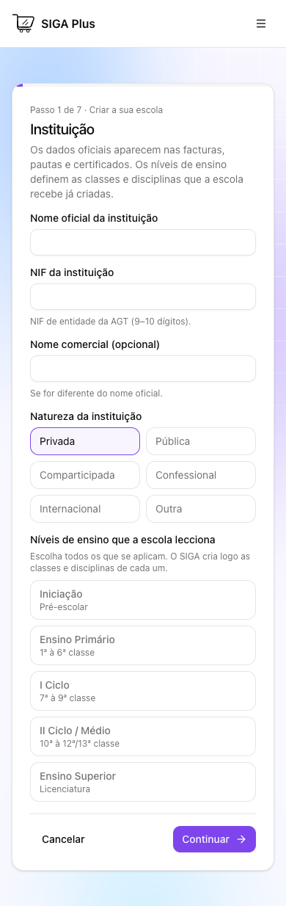

# SIGA Plus — auditoria do ciclo escolar

**Data:** 7 de Outubro de 2026, Africa/Luanda. **Decisão:** não recomendar certificação nem expansão generalizada para várias escolas com base nas evidências actuais. Há implementação extensa e controlos reais, mas foram reproduzidas falhas de recuperação em dois fluxos essenciais, há vulnerabilidades de dependências e a jornada anual integrada não pôde ser executada em ambiente isolado.

Este é o relatório da execução efectivamente realizada. **Não é uma declaração de cobertura funcional completa.** Inventário completo das superfícies encontradas é diferente de validação completa das operações. A matriz conserva explicitamente os cenários bloqueados e não testados. Nenhuma escola de teste, conta, cobrança, permissão, mensagem, migração ou publicação foi criada/alterada na produção nesta auditoria.

**Entregáveis:** [940 linhas de cobertura](matriz-cobertura.csv), [11 achados](falhas.md), [rotas](rotas.csv), [funções de servidor](funcoes-servidor.csv), [tabelas](tabelas.csv), [módulos](modulos.csv), [automações](automacoes.csv) e [instruções de reprodução](REPRODUCAO.md). A matriz tem 18 verificações funcionais no âmbito descrito, 8 com falha, 5 parciais, 200 cenários bloqueados e 709 superfícies não testadas. Estas linhas não são funcionalidades únicas nem uma percentagem de cobertura do produto.

## 1. Diagnóstico executivo

O sistema compila, tem 30 pastas de funcionalidades, 492 funções TanStack de servidor identificadas, 217 declarações de rotas/páginas/APIs inventariadas e uma produção com 189 tabelas públicas, todas com RLS, e 359 políticas. Existem mecanismos de escopo escolar, limitação de alunos por conta, restrição de professor por turma, MFA, transacções financeiras e bloqueios académicos. A presença destes mecanismos não certifica todos os caminhos que os utilizam.

Os três defeitos de comportamento reproduzidos com entradas sintéticas foram:

1. **F01, P1:** falha de colocação em turma após criar o aluno; reenviar a matrícula manual cria outro aluno e não regista histórico de estado. Reproduzido no handler real com persistência simulada e injecção de falha, não numa escola real.
2. **F02, P1:** ao seleccionar outro ano lectivo, fechar o anterior e falhar a activação do novo deixa o anterior fechado. Reproduzido no handler real com banco simulado.
3. **F03, P2:** CSV de 25.001 linhas devolve só 25.000, sem informar a linha omitida. Reproduzido no parser real.

Além disso, a auditoria de dependências encontrou um aviso alto e um crítico; o lint global falhou; apenas 3 de 64 contas têm MFA verificado; a alteração directa de `staff_module_grants` não contém condição MFA no catálogo consultado; e o PayFlow publicado está saudável na D1 mas sem fornecedor, SSO, ligação SIGA e liquidação configurados. Os 11 achados, com gravidade, perfil, pré-condições, reprodução, causa, correcção e aceitação, estão em [falhas.md](falhas.md) e [falhas.csv](falhas.csv).

**Não foi demonstrada fuga entre escolas nem corrupção financeira nesta execução.** As sondas anónimas foram recusadas e os predicados de integridade consultados deram zero anomalias. Não houve teste autenticado A/B nem ensaio de concorrência PostgreSQL real, portanto não se conclui ausência de P0.

## 2. Repositório, ambientes e versão publicada

| Elemento                 | Evidência observada                                                                                              |
| ------------------------ | ---------------------------------------------------------------------------------------------------------------- |
| Repositório              | `fernandotunas6-bot/onsoft-replica-dev`, remoto HTTPS GitHub                                                     |
| Branch auditada          | `docs/auditoria-critica-2026-10-06`                                                                              |
| Commit local             | `df5009b39f03b69acc2cc69db235682bfd994e15`                                                                       |
| Árvore inicial           | Quatro ficheiros já modificados: relatório 13, cleanup E2E, helper live e teste cleanup; preservados             |
| Runtime local            | Node `v24.18.0`; macOS; Chrome headless `150.0.7871.125` disponível                                              |
| Supabase configurado     | `xodgfmxiaunpamctfeea`, identificado pelo projecto como produção                                                 |
| Branches acessíveis      | Apenas `main`; nenhum staging/preview isolado confirmado                                                         |
| Snapshot no repositório  | Capturado a `2026-10-06T08:39:05.488Z`; 189 tabelas                                                              |
| Catálogo live            | PostgreSQL 17.6; 189 tabelas públicas; 359 políticas; 6 buckets; `cron` não instalado                            |
| WEB/ADMIN/DOC publicados | SHA declarado `847dda1fc40df7b88d7aafed40864266762d99dd`, `commit_dirty=true`, deploys de 07/10 às 09:15, Luanda |
| SIGA Worker publicado    | Versão `4428c830-e666-4785-b330-fa7d45615213`, número 111, deploy às 09:16:46, Luanda                            |
| PayFlow Worker publicado | Versão `fdac5d2e-9149-4314-b8cb-d3883afe7731`, número 21, deploy às 09:16:08, Luanda                             |

As versões Worker não declaram SHA nas annotations consultadas. As Pages indicam uma árvore com alterações locais. **Não se afirma identidade entre o checkout auditado e todos os artefactos publicados.** Os metadados foram lidos; os deploys observados não foram executados por esta auditoria. Os resultados locais referem-se à branch acima; os resultados HTTP/catálogo referem-se à produção nos instantes da recolha. [Metadados](evidencias/deployments.json), [inventário](evidencias/inventory-summary.json).

### Arquitectura e serviços

| Aplicação                 | Responsabilidade e implementação                                                                                                 |
| ------------------------- | -------------------------------------------------------------------------------------------------------------------------------- |
| SIGA, raiz                | Operação escolar; React/TanStack Start/Router/Query, Vite, Zod; server functions com Supabase Auth e cliente de serviço guardado |
| WEB, `painel/web`         | Comercial e wizard de sete etapas; Vite/React; chama a API SaaS do SIGA                                                          |
| ADMIN, `painel/admin`     | Administração da plataforma; Next.js/exportação estática; segurança efectiva nas APIs, não apenas no gate visual                 |
| PAYFLOW, `painel/payflow` | Cobrança e conciliação; Vinext/React/Cloudflare D1; integração com SIGA depende de configuração                                  |
| DOC, `painel/docs`        | Documentação pública em VitePress                                                                                                |
| Desktop                   | Frontend local `desktop/`, Rust Tauri v2 em `src-tauri/`; portal escolar remoto com capabilities próprias                        |

O backend escolar é um Postgres partilhado por escolas, com `school_id` e memberships. PayFlow usa outra base, D1, pelo que sincronização e liquidação são fronteiras de consistência adicionais. A stack efectiva difere de números antigos da documentação: o build local usou Vite 8.2.1. Os manifests e lockfiles são as fontes de dependências; não foram actualizados.

Os papéis canónicos são Administrador, Secretaria, Tesouraria, Professor, Encarregado, Aluno e Utilizador. Direcção é responsabilidade/permissão a resolver na política existente, não um oitavo papel canónico inventado. `platform_admins` é distinto de administrador escolar. Os grants por módulo não elevam alunos/encarregados; RH e configurações têm restrições próprias. Revisão de [access-policy.ts](../../../src/features/auth/access-policy.ts), [sga-admin.ts](../../../src/integrations/supabase/sga-admin.ts) e [platform-guard.ts](../../../src/features/saas/platform-guard.ts).

## 3. Acessos e método

Disponível: código e testes locais, runtime Node/Chrome, leitura do catálogo/grants/funções/migrações/advisors via Supabase, consultas agregadas de integridade, HTTP público e metadados Cloudflare. A ferramenta do Browser integrado não estava exposta; utilizou-se Playwright local com Chrome headless. Não foi usado um browser com sessão pessoal existente.

Indisponível ou não confirmado: projecto de staging, contas de teste por papel com AAL1/AAL2, duas escolas isoladas, credenciais sandbox de fornecedores, escola com um ano completo de dados sintéticos, pacote nativo instalado e dispositivos físicos. Foi pedido o local de staging durante o trabalho; nenhuma configuração isolada foi disponibilizada nesta execução. Não se usaram credenciais de produção para criar fixtures.

A interface foi observada em 1440×900 e 390×844. Todos os pedidos externos do browser foram bloqueados. Não houve login real, envio de recuperação, signup, OAuth, pagamento ou notificação. Os handlers de F01/F02 correram com o código de produção local, guardas/clientes substituídos por mocks e falhas explicitamente injectadas. Assim se comprova a sequência do handler, sem afirmar que a base real aceitou aquelas escritas.

Os ensaios SQL usaram PGlite em memória e migrações reais, várias aplicadas duas vezes pelos testes. As fixtures simulam partes da autorização e omitem algumas FKs externas. Isto verifica rollback/idempotência nos casos ensaiados; não reproduz concorrência entre sessões PostgreSQL, ambiente Auth/Storage completo ou UI.

As consultas de produção retornaram metadados e contagens, sem nomes de alunos, documentos, contactos, tokens ou valores individualizados. A sonda anónima descartou o conteúdo da resposta e guardou só código e quantidade de linhas.

## 4. Cobertura e inventários

A [matriz de cobertura](matriz-cobertura.csv) contém cenários do pedido, funcionalidades adicionais, funções servidor e rotas. **Estado de um cenário não se transfere para o módulo inteiro.** Uma rota com HTTP 200 e login visível pode ter a operação escolar bloqueada/não testada noutra linha. As contagens de linhas não medem percentagem do produto validado.

| Inventário                                   | Conteúdo                                                                                                                   |
| -------------------------------------------- | -------------------------------------------------------------------------------------------------------------------------- |
| [rotas.csv](rotas.csv)                       | 217 declarações encontradas nos cinco frontends/API; parâmetros e URL final exigem confirmação individual                  |
| [funcoes-servidor.csv](funcoes-servidor.csv) | 492 server functions, método, ficheiro/linha e sinais textuais de guardas; guardas transitivas não são deduzidas por regex |
| [modulos.csv](modulos.csv)                   | 30 pastas de funcionalidades; contagens de ficheiros/testes por pasta são inventário, não cobertura instrumentada          |
| [tabelas.csv](tabelas.csv)                   | 189 tabelas do snapshot, colunas e controlos de acesso; live confirmou totais e amostras específicas                       |
| [automacoes.csv](automacoes.csv)             | Workflows, crons declarados e referência a @live; existência não prova execução bem sucedida                               |
| [falhas.csv](falhas.csv)                     | Os 12 campos exigidos para cada um dos 11 achados                                                                          |

### Estado dos módulos

| Área                                  | O que ficou comprovado                                                                                                                       | Limite para operação escolar                                                               |
| ------------------------------------- | -------------------------------------------------------------------------------------------------------------------------------------------- | ------------------------------------------------------------------------------------------ |
| Escola / onboarding                   | Wizard renderiza e recusa campos vazios; inventário do provisionamento                                                                       | Criação, responsável, domínio e persistência sem teste integrado                           |
| Auth / acessos                        | Login obrigatório nos cinco URLs sondados; três APIs ADMIN recusam anónimo; catálogo memberships/roles/MFA                                   | Login, recuperação, Google, renovação, revogação e alternância por contas reais pendentes  |
| Pessoas / alunos                      | Escopo por escola/conta/professor revisto; predicados live sem ligações cruzadas                                                             | CRUD, uploads e vínculos de portais sem jornada real                                       |
| Importação                            | Parser real de 200 linhas; F03; registry com 22 importadores reais, não apenas selector                                                      | Nenhuma importação de 200 alunos persistida, interrompida ou repetida em staging           |
| Matrícula                             | F01; RPCs `register_student`/`enroll_student` e controlos de escola/MFA/lotação revistos                                                     | Candidatura→obrigações→portal não executado de ponta a ponta                               |
| Estrutura / turmas / salas            | Ensaio SQL de mudança de turma, lotação e integridade; consultas existentes sem cruzamentos                                                  | Edição/publicação, horários e conflitos simultâneos não exercitados por UI/API             |
| Calendário / ano                      | F02; ensaios académicos e revisão dos períodos                                                                                               | Fecho de ano com todas as pendências e renovação automática não comprovados                |
| Presenças / avaliações                | Ensaios locais de bloqueio; funções e testes inventariados                                                                                   | Chamada/QR/justificação/avaliação por papel real pendentes                                 |
| Notas / pautas                        | 1681 cálculos independentes; ensaio SQL de ano/períodos; código da pauta exige completude para decisão anual                                 | Sem conferência de notas persistidas, documentos assinados e decisões de turma real        |
| Financeiro escolar                    | 38 facturas/31 recibos: predicados de saldo/estado sem anomalias; SQL de multa, liquidação e estorno passa                                   | Caixa, adiantamento, reembolso e portais com movimentos sintéticos por verificar           |
| PayFlow                               | Health D1 funcional; 48 testes locais aprovados                                                                                              | Integração publicada desconfigurada, F05; nenhum dinheiro usado                            |
| Arquivos / documentos                 | 5 buckets privados e só logótipos públicos; caminhos/escopos e emissão inventariados                                                         | Sem upload/download/autenticidade nem QA visual de PDF/XLSX real                           |
| RH / salários                         | Ensaios locais de confirmação, anulação e destino salarial aprovados                                                                         | Sem assinatura, pagamento/estorno e QR em conta de teste real                              |
| Comunicação / chat                    | Ensaio SQL de integridade do chat; transportes, webhooks e permissões inventariados                                                          | Nenhuma mensagem ou notificação enviada; entrega não comprovada                            |
| Alumni                                | Portais, consentimento, portefólio, matching e pipeline inventariados                                                                        | CRUD, privacidade e auto-serviço autenticados não testados                                 |
| Ensino Superior                       | Rotas de cadeiras/pautas/histórico/certificado e estatutos inventariadas; ensaio local estatutos passa                                       | Inscrição/transição/certificação por regulamento institucional não comprovadas             |
| Risco / planos de aula                | Módulos sensíveis e guardas inventariados                                                                                                    | Permissões e dados/evidências reais sem teste integrado                                    |
| Catracas                              | API por dispositivo, QR/cartão e testes existentes inventariados                                                                             | Nenhum dispositivo físico, replay autenticado ou abertura mecânica testado                 |
| Inteligência / spotlight / relatórios | Sugestões/indicadores inventariados                                                                                                          | Exactidão com volume representativo e dados de todas as áreas não conferida                |
| Biblioteca / capelania                | Pesquisa não encontrou módulo operacional autónomo de empréstimos/multas ou capelania                                                        | Referências a «biblioteca» são sobretudo arquivos; não se inventa funcionalidade existente |
| Desktop / PWA                         | Contrato de capabilities, CSP, lockfiles/versões passa; 40/40 testes locais e build frontend passam após instalar dependências pelo lockfile | Instalação, arranque nativo, updater, impressão física, offline e conflitos sem teste real |

## 5. Jornada integrada obrigatória

**Resultado: bloqueada antes da etapa 1 por inexistência de ambiente isolado confirmado.** Nenhuma das 17 etapas foi concluída numa escola de teste com confirmação UI→API→DB. Os ensaios locais abaixo são evidências complementares, não substitutos da jornada.

| Etapa                                   | Resultado esperado                               | Estado / dependência                               | Evidência complementar disponível                |
| --------------------------------------- | ------------------------------------------------ | -------------------------------------------------- | ------------------------------------------------ |
| 1. Escola e administrador               | Tenant, escola e membership persistidos uma vez  | Bloqueado: staging e destinatário sintético        | Wizard; API SaaS; F04                            |
| 2. Ano, períodos e regras               | Ano activo, períodos e configuração persistidos  | Bloqueado: etapa 1                                 | F02; ensaios annual-sheet-terms                  |
| 3. Classes, disciplinas, salas e turmas | Estrutura consistente na escola A                | Bloqueado: etapas 1–2                              | Inventário; testes de schema/integridade         |
| 4. Professores e funcionários           | Contas e vínculos correctos                      | Bloqueado: etapa 1 e contas de teste               | Inventário de Pessoas/RH/Acessos                 |
| 5. Aluno manual                         | Pessoa/aluno/processo e histórico consistentes   | Bloqueado: etapas 1–3 e AAL2                       | F01; SQL audit-transactions                      |
| 6. Importar lote                        | 200 alunos persistidos e contagens reconciliadas | Bloqueado: banco isolado                           | Parser de 200; F03; nada importado               |
| 7. Matricular e distribuir              | Sem duplicação, vagas e vínculos correctos       | Bloqueado: etapas 3, 5–6                           | SQL enrollment-class-change; RPCs revistas       |
| 8. Obrigações financeiras               | Contratos/propinas/facturas da matrícula         | Bloqueado: etapa 7 e regras configuradas           | SQL fee-items-grade-level / late-fee             |
| 9. Pagamento e documento                | Movimento sandbox, recibo e saldo correctos      | Bloqueado: etapa 8 e fornecedor sandbox            | SQL gateway-settlement; F05                      |
| 10. Horários e eventos                  | Agenda publicada sem conflitos                   | Bloqueado: etapas 2–4                              | Inventário calendário/horários                   |
| 11. Presenças e avaliações              | Sessões e instrumentos persistidos               | Bloqueado: etapas 7, 10 e conta professor          | SQL assessment-closed-term                       |
| 12. Notas e médias                      | Notas e cálculo independente coincidem           | Bloqueado: etapa 11                                | 1681 médias; suite académica local               |
| 13. Boletim e pauta                     | Documentos completos e autorizados               | Bloqueado: etapa 12 e modelos/assinantes           | Pauta-export / grade-sheets; sem PDF gerado      |
| 14. Portais                             | Cada papel vê exclusivamente o seu âmbito        | Bloqueado: contas por papel e dados anteriores     | Renders mock; sonda anónima e APIs 401           |
| 15. Fechar período                      | Novas alterações recusadas conforme regras       | Bloqueado: etapa 12 e autoridade de fecho          | SQL assessment-closed-term; bloqueios revistos   |
| 16. Renovação / transição               | Novo ano e matrículas com histórico              | Bloqueado: decisões académicas e etapas anteriores | F02; lógica de transição inventariada            |
| 17. Isolamento escola B                 | UI/API/DB/arquivos/cache recusam recursos B      | Bloqueado: duas escolas e contas isoladas          | SQL local A/B parcial; catálogo e contagens live |

Trocar o status do ano ou fechar uma pauta não comprova encerramento anual de todas as áreas. A aceitação desta jornada precisa de critérios institucionais para pendências académicas, financeiras, documentais e renovação.

## 6. Segurança, integridade e integrações

As 12 tabelas sensíveis da lista da sonda anónima devolveram `42501`, zero linhas: salários, contratos/vínculos, facturas/recibos, segredos de integração, alunos/pessoas/notas, memberships e profiles. [Resultado](evidencias/anon-probe.json). Três GETs sem sessão às APIs SaaS `me`, `tenants` e `stats` devolveram 401. São provas de recusa nesses acessos, não uma auditoria de todos os endpoints.

`students` tem política **RESTRICTIVE** «School staff only», SELECT/UPDATE concedidos a authenticated e UPDATE com MFA. Não se classificou a sua política `ALL` como autorização permissiva de INSERT: o catálogo confirma que INSERT não está concedido. O servidor deve continuar a respeitar o âmbito adicional do aluno/encarregado e do professor ao usar a chave de serviço. [Catálogo específico](evidencias/student_access-data.json).

A pesquisa textual inicial encontrou políticas sem `is_aal2`, mas várias têm políticas restritivas por comando ou nem têm concessão de escrita. **Não se toma a contagem bruta de 58 tabelas como 58 bypasses MFA.** F08 foi limitado a `staff_module_grants`, revisto com privilégios e ausência de trigger. Destinos salariais, por exemplo, têm políticas restritivas separadas e não foram classificados como bypass apenas pela política `ALL`.

O advisor devolveu 67 informações «RLS sem política», 17 avisos de funções SECURITY DEFINER executáveis por authenticated e um aviso de protecção de senhas comprometidas. Muitas tabelas sem política são deliberadamente server-only; os 67 avisos não são 67 fugas. Cada função definer exige revisão do corpo e do grant; a contagem não comprova exploração. [Advisors](evidencias/advisors-security-data.json). A distinção entre privilégio de tabela e RLS segue a [documentação oficial do Supabase](https://supabase.com/docs/guides/database/postgres/row-level-security).

Consultas agregadas confirmaram 48 escolas/tenants, 45 alunos não apagados, 36 matrículas activas, 38 facturas, 31 recibos e uma nota. Não se encontrou relação escola-pessoa/aluno/turma/recibo cruzada, matrícula activa duplicada por ano, valor financeiro negativo, sobrepagamento, factura paga sem recibos emitidos suficientes, nota fora da escala ou mais de um ano activo na mesma escola. O conjunto é pequeno, maioritariamente marcado como E2E nos tenants, e estes predicados não detectam todas as formas de órfãos/corrupção.

**Correcção metodológica registada:** uma primeira consulta financeira usou `posted` para recibos e produziu 31 falsos candidatos. Os estados reais foram conferidos (`issued` para os 31 recibos); a consulta corrigida deu zero. Só [financial-academic-integrity-confirmed.json](evidencias/financial-academic-integrity-confirmed.json) sustenta a conclusão. O resultado inicial foi conservado para rastreabilidade, não conta como falha do produto.

| Integração                    | Implementação/estado observado                                                    | Verificação em falta                                                        |
| ----------------------------- | --------------------------------------------------------------------------------- | --------------------------------------------------------------------------- |
| Google Calendar / Apple       | Feed ICS copiado e subscrição externa; não é prova de sync bidireccional          | Criar evento e confirmar propagação/expiração/autorização em conta de teste |
| WhatsApp                      | Existem transportes/webhooks; certas ferramentas só abrem WhatsApp Web            | Entrega, estados e duplicação com destinatário sintético                    |
| Resend / e-mail               | Existem dispatch, webhook e configurações                                         | Entrega real em caixa de teste e falhas/retries                             |
| Workspace / Zoho              | Adaptadores de mailbox; modo simulado é recusado em production no código local    | Credenciais/provider e criação/suspensão/recovery em sandbox                |
| Multicaixa / Unitel / AppyPay | Referências, adapters e callbacks no código; PayFlow publicado sem provider       | Homologação quando exigida, assinatura e liquidação sandbox                 |
| SIGE / EMIS                   | Payload/exportações e adapters encontrados                                        | Aceitação/sincronização por endpoint estatal/bancário real de testes        |
| AGT / SAF-T                   | Geração/validação estrutural; algumas ferramentas copiam linha/NIF e abrem portal | Não se certificou homologação ou conformidade fiscal por este ensaio        |
| Zoom                          | OAuth/callback e ligações no código                                               | Criar reunião autorizada e testar presença/reminders em sandbox             |
| OneDrive                      | Ferramenta navega para arquivos e declara catalog-ready                           | Nenhuma sincronização de bytes externa comprovada                           |

Só instalar uma integração no catálogo não comprova transporte, entrega nem execução externa. O fallback fictício em `src/lib/saas/provisioning-service.ts` foi identificado no código, mas a pesquisa não encontrou consumidores fora da própria declaração; não foi apresentado como dashboard actualmente activo. O fallback de tenant local é limitado a hostname de desenvolvimento; não é um bypass de produção demonstrado.

A auditoria de dependências confirmou versões afectadas por [GHSA-6qxp-vccf-f47h](https://github.com/advisories/GHSA-6qxp-vccf-f47h) e [GHSA-pqg4-j6r4-53mv](https://github.com/advisories/GHSA-pqg4-j6r4-53mv). O primeiro depende do uso de OAuth cliente e de servidor não confiável; o segundo veio pela cadeia de ferramentas de desenvolvimento. Não foram explorados. Não se confundiu gravidade crítica da dependência com exposição P0 comprovada no SIGA.

## 7. UX, desempenho e operação

Login e primeira etapa do wizard não apresentaram overflow horizontal em 1440×900 ou 390×844. Login vazio ficou inválido nos campos obrigatórios; wizard vazio mostrou «Nome da escola obrigatório» e «NIF obrigatório». Foi observado foco por Tab. Não houve revisão integral de ordem de foco, leitores de ecrã, contraste, modais autenticados, tabelas extensas ou teclado virtual real. [Capturas/interacções](evidencias/browser-interactions.json).

Estes são testes de viewport no Chrome desktop headless, **não dispositivos móveis reais**. Nenhum Safari/Firefox/WebView nativo foi testado. Erros de recursos externos durante essas sessões resultam do bloqueio intencional de rede; não foram registados como falhas de produção.

As sondas HTTP públicas deram 200 nos quatro portais consultados e no health PayFlow; este último incluiu D1 `ok` e latência interna de 61 ms numa recolha. Tempos cliente são amostras únicas, incluem TLS/rede e não medem capacidade. O servidor local foi executado em modo desenvolvimento enquanto a máquina também corria checks; os seus tempos de carga não são métricas de produção. Não houve carga, rede lenta controlada, 200 alunos persistidos, testes de utilizadores simultâneos, memória/CPU do servidor nem percentis de latência.

Não foram ensaiados backup/restauro, monitorização/alertas, execução efectiva dos crons, migração integral de um banco vazio, resolução de conflitos offline ou instalação/actualização assinada desktop. Ausência de `pg_cron` não implica ausência de tarefas: existem rotas cron e workflows externos inventariados. Não se certificou que estão agendados e configurados.

## 8. Validações executadas

| Check                          | Resultado                                                                                       | Evidência                                                                                                  |
| ------------------------------ | ----------------------------------------------------------------------------------------------- | ---------------------------------------------------------------------------------------------------------- |
| `npm run typecheck`            | Exit 0                                                                                          | [typecheck.log](evidencias/typecheck.log)                                                                  |
| `npm run build`                | Exit 0; cliente e SSR concluídos                                                                | [build.log](evidencias/build.log)                                                                          |
| `npm run siga:check`           | Exit 0; módulos e 13 testes de navegação                                                        | [modules.log](evidencias/modules.log)                                                                      |
| `npm run lint`                 | Exit 1; 70 erros, 47 avisos                                                                     | [lint.log](evidencias/lint.log)                                                                            |
| `npm test -- --maxWorkers=4 …` | **Exit 1**; 469 ficheiros, 3095 passam, 2 falham, 3 saltados; total 3100                        | [test-summary.json](evidencias/test-summary.json), [vitest.json](evidencias/vitest.json)                   |
| Portais isolados               | 3/3 passam; não apaga falhas da suite completa                                                  | [portal-rerun.log](evidencias/portal-rerun.log)                                                            |
| Probes de auditoria            | 5/5 passam nas asserções do comportamento observado, incluindo três defeitos                    | [probes.log](evidencias/probes.log)                                                                        |
| Ensaios SQL PGlite             | 15/15 scripts, todos exit 0                                                                     | [sql-results.json](evidencias/sql-results.json)                                                            |
| PayFlow                        | Build/script retorna 0; 48/48 testes passam; avisos do ambiente conservados                     | [payflow-tests.log](evidencias/payflow-tests.log)                                                          |
| Desktop contrato               | Exit 0                                                                                          | [desktop-check.log](evidencias/desktop-check.log)                                                          |
| Desktop suite inicial          | 8 suites não iniciaram por dependência local ausente; instalação pelo lockfile efectuada depois | [desktop-tests.log](evidencias/desktop-tests.log), [desktop-install.log](evidencias/desktop-install.log)   |
| Desktop suite após instalação  | Exit 0; 8 ficheiros, 40/40 testes passam                                                        | [desktop-tests-installed.log](evidencias/desktop-tests-installed.log)                                      |
| Desktop build frontend         | Exit 0; tipos e bundle; sem build nativo Rust                                                   | [desktop-build.log](evidencias/desktop-build.log)                                                          |
| Dependências raiz              | Exit 1; 1 alto e 1 crítico                                                                      | [dependency-audit.log](evidencias/dependency-audit.log)                                                    |
| HTTP/API públicos              | 200 nas páginas/health; 401 nas três APIs administrativas                                       | [public-http.json](evidencias/public-http.json)                                                            |
| Anónimo no banco               | 12/12 recusados com 42501; zero dados                                                           | [anon-probe.json](evidencias/anon-probe.json)                                                              |
| UI Chrome                      | 12 navegações; validação vazia e foco; redes externas bloqueadas                                | [browser.json](evidencias/browser.json), [browser-interactions.json](evidencias/browser-interactions.json) |

Os três saltados na suite completa foram dois testes debug e a sonda live sem variáveis exportadas. Esta última foi complementada pela sonda de auditoria de 12 tabelas, sem guardar linhas pessoais. A verificação live de selects do código, que lê `.env` e faz `limit=0`, executou na suite; não equivale a executar todos os handlers. As duas falhas de portal passaram isoladamente; a causa mantém-se hipótese de carga/cleanup. Não se declara «suite verde».

Houve tentativas locais interrompidas por sobrecarga e ajustes do harness de auditoria: a configuração inicial do probe incluiu inadvertidamente a suite geral e foi interrompida; uma primeira captura aguardou `networkidle` e um rótulo incorrecto, depois corrigidos. Os resultados finais citados provêm das execuções concluídas. O primeiro limite de 5 s do probe CSV foi excedido durante importação do módulo; o ensaio foi repetido com 30 s e passou. Não se classificaram esses problemas do harness como defeitos do produto.

## 9. Plano de correcção e aceitação

| Ordem | Trabalho proposto                                                                           | Dependência / aceitação                                                              |
| ----- | ------------------------------------------------------------------------------------------- | ------------------------------------------------------------------------------------ |
| 1     | **F04:** staging isolado, destinos sintéticos, duas escolas, contas por papel e MFA         | Gate que recusa ID de produção antes de qualquer E2E com escrita                     |
| 2     | **F06/F08/F09:** dependências, MFA de grants, configuração Auth                             | Revisão de alcance; provas REST AAL1/AAL2 e regressão por papel em staging           |
| 3     | **F01:** matrícula atómica ou retoma idempotente com histórico                              | Falha de turma, reenvio, BI duplicado, duplo clique e concorrência sem segundo aluno |
| 4     | **F02:** activação de ano atómica                                                           | Falha e duas activações simultâneas preservam exactamente um ano activo              |
| 5     | **F03:** parser sem truncagem silenciosa                                                    | Contagens originais/importadas/rejeitadas/pendentes reconciliam                      |
| 6     | **F05:** configurar fluxo financeiro integrado ou delimitar claramente capacidade publicada | Jornada sandbox e webhook repetido/estorno com documentos e saldos correctos         |
| 7     | **F07/F11:** gates locais estáveis e efectivos                                              | Lint e suite completa passam em condições documentadas, sem ocultar falhas           |
| 8     | **F10:** publicação rastreável por app                                                      | Artefacto de árvore limpa, SHA exacto em cada aplicação; smoke no mesmo conjunto     |
| 9     | Executar as 17 etapas e aprofundar todos os cenários ainda bloqueados/não testados          | Evidência UI→API→DB; documentos; fecho/renovação; isolamento A/B                     |
| 10    | Ensaios operacionais: carga, restauro, mobile real, desktop assinado/offline                | Resultados e limites mensuráveis, dados apenas de staging                            |

As correcções são **propostas**. Esta execução não as implementou, não alterou migrações/configuração e não publicou nada. Uma futura intervenção precisa de autorização para o âmbito concreto; não é necessário repetir aprovação para continuar consultas e testes já autorizados em ambiente seguro.

## 10. O que falta para responder ao objectivo anual

Faltam, explicitamente: criação real de escola isolada; persistência de definições depois de logout/login; contas de todos os papéis; Google/OTP/recuperação/MFA completos; revogação e alternância de escola; CRUD e upload reais; importação persistida de 200 alunos com interrupção/repetição; candidatura→matrícula→contrato→financeiro→documentos→portal; vagas e numeração concorrentes em PostgreSQL; QR/replay e dispositivos; notas persistidas e decisão académica por regras da instituição; QA visual de boletins/pautas/PDF/Excel extensos; fecho efectivo e renovação; reembolsos/adiantamentos; notificações com destinos de teste; isolamento autenticado A/B em todas as superfícies; tarefas agendadas; volume/latência; logs/alertas; backup/restauro; instalação/updater/offline/conflitos desktop; toque/rotação/teclado virtual reais.

Os 709 inventários de funções/rotas marcados «Não testado» não desapareceram por a suite local passar em outros cenários. Há código e provas parciais suficientes para orientar a correcção, mas **a capacidade de uma escola utilizar todo o ano lectivo ainda não está certificada**. A próxima evidência decisiva é uma jornada completa num projecto isolado com a mesma versão que será publicada.
