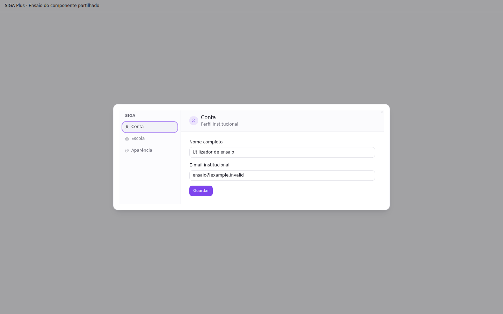
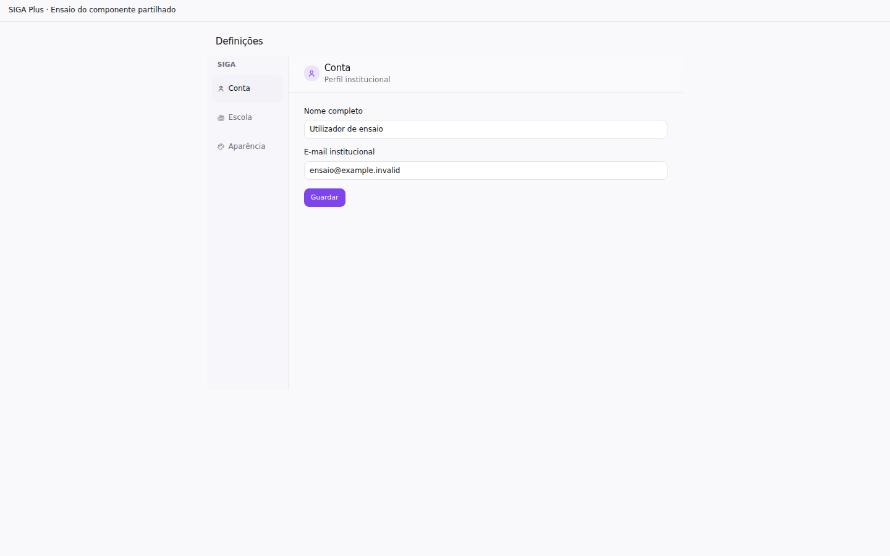
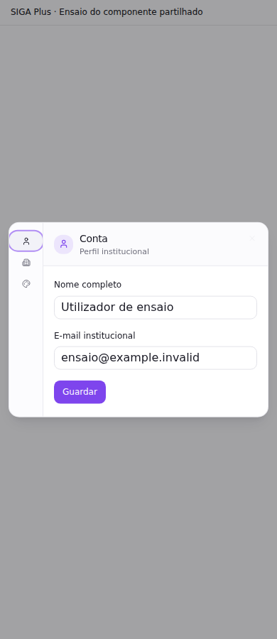
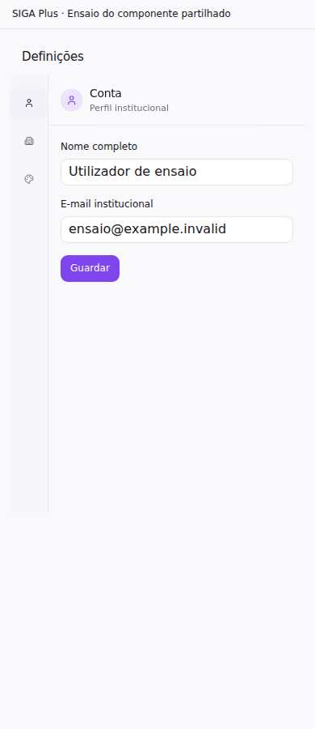

# Execução do padrão visual — 23/10/2026

Contrato: [VISUAL_MASTER_2026.md](VISUAL_MASTER_2026.md). Esta matriz acompanha
**todas as dez fases**. O padrão está registado; a execução integral está parcial.
Não considerar o sistema todo validado por causa dos testes abaixo.

## Diagnóstico por prioridade

| Prioridade / natureza  | Evidência inicial                                                                                       | Correcção / estado                                                                                             |
| ---------------------- | ------------------------------------------------------------------------------------------------------- | -------------------------------------------------------------------------------------------------------------- |
| P1 funcional / visual  | `/configuracoes` redireccionava sempre para `/` e para um modal grande.                                 | Página por omissão; opção `settingsModal` na preferência existente da escola.                                  |
| P1 visual / interacção | Menu recolhido voltava a expandir com hover, mudando a largura do conteúdo.                             | Compacto por omissão; expansão por botão; opção `expandedSidebar` por escola.                                  |
| P1 funcional           | `StackNav.close` capturava estado dirty antigo; trocar categoria ignorava alterações pendentes.         | Guarda actualizada e testes de confirmação; navegação para fora da página usa bloqueador do router.            |
| P1 funcional           | Pedido de abrir definições sem painel devolvia o mesmo `undefined` que ausência de pedido.              | Pedido raiz representado por string vazia e consumido uma só vez.                                              |
| P1 funcional           | FormModal/QuickModal não bloqueavam directamente Enter repetido nem `disabled` no handler.              | Bloqueio síncrono até à resolução do callback, incluindo WizardModal; feedback de operação pendente.           |
| P2 acessibilidade      | Categorias das Definições tinham alvos com 27–32,14 px de altura no ensaio.                             | Altura mínima de 44 px, confirmada nas seis larguras.                                                          |
| P2 visual              | PremiumModal tinha halo desfocado, sombra forte e destaque decorativo; wizard simples usava largura xl. | Cabeçalho neutro e sombra suave; wizard sem painel visual usa lg, preservando campos e acções.                 |
| P1 auditoria restante  | Existem outros consumidores com tamanho xl/2xl/full.                                                    | Inventário estático em `evidence/2026-10-23/large-modal-inventory.json`; não migrados indiscriminadamente.     |
| P1 desempenho          | Inventário actual de preloads gerado para 18 módulos.                                                   | Diagnóstico de bytes disponível; latências e gargalos de rede/re-render ainda por medir em sessão autenticada. |

## Cobertura das fases

| Fase                            | Estado      | Evidência e próximo passo                                                                                                                                                                                                                                                   |
| ------------------------------- | ----------- | --------------------------------------------------------------------------------------------------------------------------------------------------------------------------------------------------------------------------------------------------------------------------- |
| 1 — auditoria integral          | parcial     | Branch/HEAD/estado inicial limpos, arquitectura e handoff lidos; 18 módulos/186 ficheiros do inventário verificados. Falta auditoria runtime completa de todos os módulos.                                                                                                  |
| 2.1 — superfícies               | parcial     | Definições em página, coluna menor; PremiumModal mais discreto; rever cartões, bordas, sombras, composição e alinhamentos em cada módulo.                                                                                                                                   |
| 2.2 — tipografia/nitidez        | por auditar | Inter e tokens preservados; falta medir contraste, imagens, SVG, pesos, densidade e hierarquia em todas as páginas.                                                                                                                                                         |
| 2.3 — componentes universais    | parcial     | StackedModal, SettingsCenter, FormModal, QuickModal, WizardModal, PremiumModal e SequentialSheetModal refinados; falta revisão integral de inputs, selectores, listas, filtros, paginação, pesquisa, calendário, abas, notificações, estados e dashboards.                  |
| 3 — navegação contextual        | parcial     | Menu compacto, sem expansão automática; preferências institucionais; guardas de acesso mantidas. Falta validar todos os contextos, cabeçalhos, escola activa, rotas e teclado virtual.                                                                                      |
| 4.1 — interacções               | parcial     | Pendência local e bloqueio de envios em três formulários; faltam estados, skeletons, scroll, cache de filtros e feedback dos outros consumidores.                                                                                                                           |
| 4.2 — animações                 | parcial     | Não foi adicionado vídeo nem alterado o logótipo. Falta medir durações/frames e movimento reduzido em todas as superfícies.                                                                                                                                                 |
| 4.3 — toque                     | parcial     | Categorias ≥44 px no ensaio; envios repetidos bloqueados nos componentes cobertos. Faltam sobreposições, scroll, foco, menus e duplo envio nos restantes formulários.                                                                                                       |
| 5.1 — frontend                  | parcial     | Build e inventário de preloads disponíveis. Falta baseline de produção comparável, profiling de render, imagens/fontes, listas grandes, imports, cache e cálculos. Sem novos pacotes.                                                                                       |
| 5.2 — backend/dados             | bloqueado   | Nenhum SQL/API/RLS alterado. Falta acesso de teste autorizado para medir consultas, índices, cache, payload e integrações sem escrever em escolas reais.                                                                                                                    |
| 5.3 — objectivos mensuráveis    | bloqueado   | Comparação geométrica abaixo. INP/LCP/CLS p75 e FPS reais ainda não medidos; exigem ambiente instrumentado e amostra adequada.                                                                                                                                              |
| 6 — módulos                     | parcial     | Melhorias partilhadas propagam aos consumidores; auditoria individual no inventário abaixo ainda não está concluída.                                                                                                                                                        |
| 7 — dispositivos e browsers     | parcial     | Chromium headless: 390/767/768/1023/1024/1440 px no componente isolado. Android/iOS/tablets/Windows/macOS físicos, Safari/Edge/Firefox, orientação, zoom e rede lenta continuam por validar. Flutter não alterado neste incremento Web; não usar Mobile V4 como substituto. |
| 8 — acessibilidade/segurança    | parcial     | Testes de guardas, fecho, foco de Radix e bloqueio de envios; sem alterações a auth/RLS/regras de negócio. Faltam leitores de ecrã/contraste AA e isolamento remoto com duas escolas e múltiplos perfis.                                                                    |
| 9 — regressão e percursos reais | parcial     | Testes e ensaio reproduzível abaixo. Auth/MFA/escolha de escola/matrículas/notas/pagamentos/arquivo/pesquisa completos exigem contas de ensaio; não executados em produção.                                                                                                 |
| 10 — entrega                    | parcial     | Contrato completo ligado a AGENTS.md, evidências e matriz versionados; commits e PR devem acompanhar o estado final. Sem deploy ou migrações.                                                                                                                               |

## Inventário por módulo

Estado refere-se à **auditoria integral deste contrato**, não à existência das funcionalidades.

| Módulo                                    | Estado      | Fonte                                                                                                                                                                                                                                                                                                                                                                                                                                                                                                                                       | Próximo passo                                                                      |
| ----------------------------------------- | ----------- | ------------------------------------------------------------------------------------------------------------------------------------------------------------------------------------------------------------------------------------------------------------------------------------------------------------------------------------------------------------------------------------------------------------------------------------------------------------------------------------------------------------------------------------------- | ---------------------------------------------------------------------------------- |
| Dashboard (`dashboard`)                   | por auditar | `src/routes/index.tsx`                                                                                                                                                                                                                                                                                                                                                                                                                                                                                                                      | Auditar com dados controlados e perfil autorizado.                                 |
| Alunos / matrículas internas (`alunos`)   | por auditar | `src/routes/alunos/index.tsx`, `src/routes/alunos/$studentId.tsx`                                                                                                                                                                                                                                                                                                                                                                                                                                                                           | Auditar com dados controlados e perfil autorizado.                                 |
| Alumni / antigos alunos (`alumni`)        | por auditar | `src/routes/alumni.tsx`, `src/routes/alumni.$alumniId.tsx`, `src/routes/alumni.$alumniId.portfolio.tsx`, `src/routes/alumni.portal.tsx`, `src/routes/alumni.portal.portfolio.tsx`, `src/routes/alumni.portal.portfolio.showcase.tsx`, `src/routes/alumni.portal.portfolio.print.tsx`, `src/routes/alumni.insights.tsx`, `src/routes/alumni.operations.tsx`, `src/routes/alumni.communications.tsx`, `src/routes/alumni.matching.tsx`, `src/routes/alumni.documents.tsx`, `src/routes/alumni.calendar.tsx`, `src/routes/alumni.pipeline.tsx` | Auditar com dados controlados e perfil autorizado.                                 |
| Pessoas e professores (`pessoas`)         | por auditar | `src/routes/pessoas/index.tsx`, `src/routes/professores/$teacherId.tsx`                                                                                                                                                                                                                                                                                                                                                                                                                                                                     | Auditar com dados controlados e perfil autorizado.                                 |
| Área pedagógica / turmas (`pedagogica`)   | por auditar | `src/routes/pedagogica.tsx`, `src/routes/relatorios.academicos.tsx`                                                                                                                                                                                                                                                                                                                                                                                                                                                                         | Auditar com dados controlados e perfil autorizado.                                 |
| Tesouraria e faturas (`financeiro`)       | por auditar | `src/routes/financeiro.tsx`, `src/routes/faturas.tsx`, `src/routes/relatorios.financeiros.tsx`                                                                                                                                                                                                                                                                                                                                                                                                                                              | Auditar com dados controlados e perfil autorizado.                                 |
| RH, assiduidade e folha salarial (`rh`)   | por auditar | `src/routes/financeiro.rh.tsx`, `src/routes/financeiro.rh.folha.tsx`, `src/routes/financeiro.rh.faltas.tsx`, `src/routes/financeiro.rh.presenca.tsx`, `src/routes/financeiro.rh.pagamentos.tsx`, `src/routes/professor.presenca.tsx`                                                                                                                                                                                                                                                                                                        | Auditar com dados controlados e perfil autorizado.                                 |
| Documentos (`documentos`)                 | por auditar | `src/routes/documentos.tsx`                                                                                                                                                                                                                                                                                                                                                                                                                                                                                                                 | Auditar com dados controlados e perfil autorizado.                                 |
| Calendário e ICS (`calendario`)           | por auditar | `src/routes/calendario.tsx`, `src/routes/calendario.ics.tsx`                                                                                                                                                                                                                                                                                                                                                                                                                                                                                | Auditar com dados controlados e perfil autorizado.                                 |
| Comunicações (`comunicacoes`)             | por auditar | `src/routes/comunicacoes.tsx`                                                                                                                                                                                                                                                                                                                                                                                                                                                                                                               | Auditar com dados controlados e perfil autorizado.                                 |
| Acessos, grants e 2FA (`acessos`)         | por auditar | `src/routes/acessos.tsx`, `src/routes/alterar-senha.tsx`                                                                                                                                                                                                                                                                                                                                                                                                                                                                                    | Auditar com dados controlados e perfil autorizado.                                 |
| Matrícula pública (`matricula`)           | por auditar | `src/routes/matricula/$slug.tsx`                                                                                                                                                                                                                                                                                                                                                                                                                                                                                                            | Auditar com dados controlados e perfil autorizado.                                 |
| Integrações catalog-ready (`integracoes`) | por auditar |                                                                                                                                                                                                                                                                                                                                                                                                                                                                                                                                             | Auditar com dados controlados e perfil autorizado.                                 |
| Arquivos (`arquivos`)                     | por auditar | `src/routes/arquivos.tsx`                                                                                                                                                                                                                                                                                                                                                                                                                                                                                                                   | Auditar com dados controlados e perfil autorizado.                                 |
| Planos de Aula (`lesson-plans`)           | por auditar | `src/routes/planos-aula.tsx`                                                                                                                                                                                                                                                                                                                                                                                                                                                                                                                | Auditar com dados controlados e perfil autorizado.                                 |
| Motor Central de Importação (`importar`)  | por auditar | `src/routes/importar.tsx`                                                                                                                                                                                                                                                                                                                                                                                                                                                                                                                   | Auditar com dados controlados e perfil autorizado.                                 |
| Catracas e Cartão Virtual (`catracas`)    | por auditar | `src/routes/catracas.tsx`, `src/routes/api/catracas/device-scan.tsx`                                                                                                                                                                                                                                                                                                                                                                                                                                                                        | Auditar com dados controlados e perfil autorizado.                                 |
| SaaS Control Center (plataforma) (`saas`) | por auditar | `src/routes/saas-admin.tsx`, `src/routes/criar-escola.tsx`                                                                                                                                                                                                                                                                                                                                                                                                                                                                                  | Auditar com dados controlados e perfil autorizado.                                 |
| Configurações                             | parcial     | `src/routes/configuracoes.tsx`, `SettingsCenter`, `StackedModal`                                                                                                                                                                                                                                                                                                                                                                                                                                                                            | Validar persistência por escola e todos os painéis com conta autorizada.           |
| Website escolar                           | por auditar | `src/features/school-website` e `painel/escolas`                                                                                                                                                                                                                                                                                                                                                                                                                                                                                            | Conservar identidade; testar portal, responsividade e configuração.                |
| Relatórios                                | por auditar | Rotas académicas/financeiras existentes                                                                                                                                                                                                                                                                                                                                                                                                                                                                                                     | Filtros, grandes volumes e progresso de exportação.                                |
| Flutter                                   | por auditar | `mobile-flutter` se presente na revisão seguinte                                                                                                                                                                                                                                                                                                                                                                                                                                                                                            | Confirmar implementação existente e validar separadamente em dispositivos nativos. |

## Comparação observada

Ensaio **isolado**, com dados controlados. Não representa conta escolar real nem Web Vitals de produção.

| Medida                                               | Antes      | Depois       |
| ---------------------------------------------------- | ---------- | ------------ |
| Apresentação das Definições por omissão              | modal      | página       |
| Overlay / bloqueio de scroll do body                 | 1 / activo | 0 / inactivo |
| Largura da coluna das categorias, viewport 1440      | 176 px     | 132 px       |
| Altura mínima dos alvos das categorias, viewport 390 | 27 px      | 44 px        |
| Overflow horizontal nas seis larguras                | 0 casos    | 0 casos      |
| Erros de execução no ensaio                          | 0          | 0            |
| INP/LCP/CLS p75                                      | não medido | não medido   |

Os tamanhos observados dependem da escala rem existente. A mudança de largura
é de 25%; não é uma melhoria de velocidade medida. Não atribuir ganhos de tempo
ou percentis a estas capturas. O inventário actual de preloads é uma fotografia
do build; não fornece comparação antes/depois de tempo de carregamento.

### Capturas comparativas

| Antes — 1440 px                                        | Depois — 1440 px                                       |
| ------------------------------------------------------ | ------------------------------------------------------ |
|  |  |

| Antes — 390 px                                        | Depois — 390 px                                       |
| ----------------------------------------------------- | ----------------------------------------------------- |
|  |  |

### Reprodução e limites

- `node scripts/siga/visual-master/settings-browser.mjs`: baseline imutável `9defaf1`, Chromium, movimento reduzido, seis larguras, navegação de categorias e capturas. Requer o commit base acessível no Git e browser Playwright instalado.
- `node scripts/siga/check-modules.mjs`: 18 módulos, 186 ficheiros verificados.
- `node scripts/siga/performance-inventory.mjs`: artefactos/preloads e hooks dos 18 módulos; não conta pedidos realmente executados.
- `vitest run tests/ui ... --maxWorkers=2`: 48 ficheiros, 277 testes aprovados no incremento inicial. Testes finais registados no relatório de validação.
- `tsc --noEmit` com heap de 3072 MB: concluído sem erros no incremento inicial. A primeira tentativa com heap de 8192 MB foi terminada pelo ambiente (137), sem diagnóstico TypeScript.
- Build com `SIGA_NITRO_PRESET=node-server`: concluído no incremento inicial, sem publicação. Revalidar após incorporar actualizações remotas.
- ESLint dirigido: zero erros; dois avisos Fast Refresh pré-existentes no ficheiro que também exporta hooks de contexto.

A suite com mocks/DOM não prova persistência real, RBAC remoto, RLS, MFA, concorrência
financeira ou dispositivos físicos. Nenhum destes pontos pode ser marcado como
validado sem executar o respectivo percurso. Todas as fases continuam obrigatórias.

## Validação final deste incremento

PR: [#262](https://github.com/fernandotunas6-bot/onsoft-replica-dev/pull/262), em rascunho.
Código integrado com as actualizações `b06b252` (auth lazy) e `50770ec`
(navegação contextual) do main, preservando ambos os trabalhos.

| Verificação                                | Resultado                                                                                    | Limite                                                                                                                       |
| ------------------------------------------ | -------------------------------------------------------------------------------------------- | ---------------------------------------------------------------------------------------------------------------------------- |
| Suite completa `vitest run --maxWorkers=2` | 608 ficheiros aprovados; 3 ignorados. **4.174 testes aprovados; 19 ignorados**, zero falhas. | Executada sobre o incremento e auth lazy; após integrar a última correcção de sidebar, verificação dirigida abaixo.          |
| Navegação após integração de main          | 4 ficheiros, **50 testes aprovados**.                                                        | Sidebar, configurações, contexto e dados não guardados.                                                                      |
| Último ajuste de botões pendentes          | 5 ficheiros, **36 testes aprovados**.                                                        | Header de fecho visivelmente desactivado; não exige repetir a suite inteira para a prop opcional e o rótulo de preferências. |
| TypeScript após integração                 | **Zero erros**, heap 3072 MB.                                                                | Compilação local; não valida permissões no servidor.                                                                         |
| Build de produção após integração          | **Aprovado**, preset Node.                                                                   | Sem publicação; warnings existentes de directives e `inputValidator` obsoleto noutras áreas.                                 |
| ESLint dirigido                            | **Zero erros**, dois avisos Fast Refresh preexistentes.                                      | Hooks/contexto partilham o ficheiro StackedModal.                                                                            |
| Acessibilidade estática incremental        | **Aprovada**; 954 ficheiros analisados, 14 alterados.                                        | Scanner ignora primitivos Radix; não comprova WCAG AA, contraste real ou leitor de ecrã.                                     |
| Estilo incremental                         | **Aprovado**, 49/49 rotas cobertas; 14 ficheiros alterados.                                  | Checklist estática.                                                                                                          |
| Chromium isolado                           | **12 cenários aprovados**; seis larguras × antes/depois.                                     | Sem contas reais nem aparelhos físicos.                                                                                      |
| CI GitHub do código `1be6a91`              | **Pendente** na última consulta.                                                             | Não declarar CI aprovada com base nos testes locais.                                                                         |

A suite completa emite um aviso conhecido do jsdom sobre navegação completa,
mas termina com zero falhas. Os 19 testes ignorados não contam como validação.
O artefacto `preload-inventory.json` foi actualizado pelo build final; representa
apenas o estado actual. Não há medição p75 nem ganho de carregamento atribuído a
este incremento.

Commits publicados de implementação: `faa4784` (contrato), `2b0f4be` (padrões),
`fc11dc2` (integração de main), `1be6a91` (feedback de pendência). O commit de
relatório/evidências que contém esta secção não muda lógica da aplicação.

## Refinamento transversal — sidebar e modais compactos (23/10/2026)

O contrato visual da PR #262 e o trabalho paralelo das PRs #252/#259/#270 já fazem
parte de `main`. Este incremento **não** substitui sidebar, navegação ou sistema
de diálogos; preserva a margem esquerda recta, a concavidade direita, o catálogo
por papel e o estado dos formulários.

| Área | Ajuste dirigido | Prova e limite |
| --- | --- | --- |
| Navegação | Linhas raiz e subitem com alvo mínimo de 44 px em ecrãs estreitos; em desktop (lg) mantêm a densidade original 36/32 px | Contrato em `tests/ui/compact-sidebar-modal-touch.test.tsx`; testar 390/1024 px com sessão no staging |
| Diálogos simples | Acções no rodapé com alvo mínimo de 44 px, sem alterar os dois botões, labels ou `onOpenChange` | Teste de semântica com `Dialog` existente |
| PremiumModal | Sombra leve e rodapé neutro; continuam campos, título, descrição, botões e scroll existentes | Teste DOM; sem conversão de matrículas/finanças em modal simplificado |

Estado: alterações submetidas à revisão/CI; **não concluir QA autenticada nem
declarar deploy de produção sem resultados reais**. O inventário restante de
modais grandes e o ensaio de diferentes escolas continuam pendentes.
