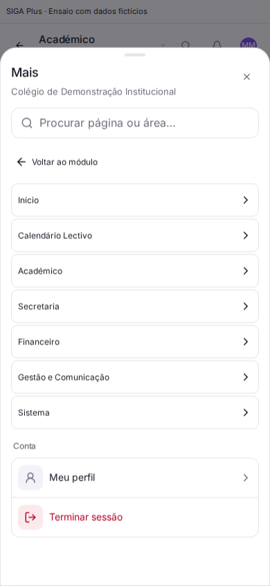
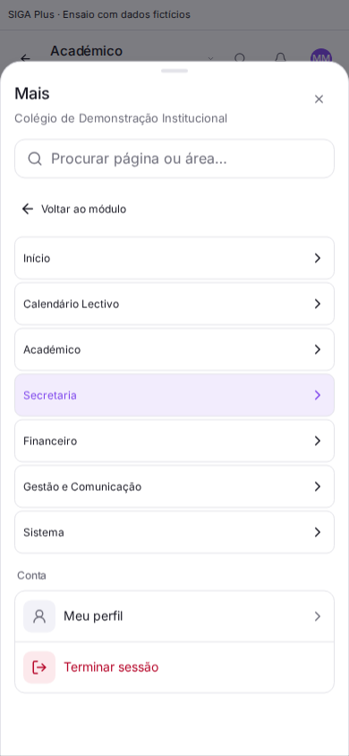

# Alinhamento da navegação contextual — 23/10/2026

## Âmbito e contribuição paralela

Base: `246cdd1a80daa548402f56571a0b556130491731` de `main`.
Integra a [PR #256](https://github.com/fernandotunas6-bot/onsoft-replica-dev/pull/256),
commit original `f69c0779832981e22ef46fa61ba68759a01dc1ad`, mantendo o seu histórico
e sem modificar a branch de origem.

Foram recuperadas orientações resumidas do trabalho paralelo: refinar o AppShell
e a sidebar existentes, reutilizar componentes, preservar identidade, permissões,
dados e regras de negócio, e validar desktop/mobile. O prompt integral e a conversa
em tempo real do outro agente não estão disponíveis nesta sessão.

A instrução actual limita esta fase à navegação. Os modais existentes não foram
alterados; fica registada a preferência por modais simples, objectivos e necessários.

## Implementação

- `AppSidebar.tsx`: contribuição da PR #256 mantém a área seleccionada nas páginas
  de detalhe, com a mesma resolução de caminhos e parâmetros dos destinos.
- `MoreHub.tsx`: o catálogo «Todas as áreas» mantém a indicação da área actual no
  telemóvel, mesmo ao explorar outra área. Usa os destinos já filtrados por perfil,
  permissões e plano; não cria outro catálogo de autorização.
- O botão da área usa `aria-current="true"`; os links das páginas continuam a usar
  `aria-current="page"`. Mantém foco visível, cores institucionais e comportamento
  existente de fechar a gaveta ao seleccionar uma página.
- Mantidos o lado esquerdo recto e o encontro inverso da sidebar com o conteúdo.

## Antes e depois

Ensaio com componentes reais, conta/router/rede controlados e dados fictícios.
Não são capturas autenticadas de produção. A página simulada é
`/alunos/aluno-teste`; o cabeçalho atrás da gaveta é apenas conteúdo de demonstração.

| Antes: área sem destaque | Depois: Secretaria identificada |
| --- | --- |
|  |  |

## Validação efectuada

- Node 24: **76 testes aprovados em 5 ficheiros** (sidebar, menu mobile,
  contexto, árvore académica e portal-engine).
- Reexecução após acrescentar a asserção do portal do aluno: **11 testes mobile
  aprovados**. ESLint nos quatro ficheiros TypeScript alterados e `git diff --check`.
- Chromium, 390 px: antes/depois do catálogo numa página de detalhe, navegação por
  teclado para Secretaria, matrícula com parâmetros preservados, fecho da gaveta
  e ausência de overflow horizontal.
- Chromium, 390 e 1440 px: perfis simulados Aluno, Encarregado e Professor,
  áreas académicas, frequência/notas no mesmo contexto, calendário directo,
  ausência de destinos administrativos e parâmetros preservados. Nas três
  variantes mobile, a gaveta fecha após navegação.
- Resultados estruturados: `sidebar-alignment-results.json` e
  `portal-areas-browser-results.json`.

## Pendente

Typecheck e build globais desta branch dependem da CI. Os testes apresentados não
validam contas reais, autorização por escola no backend, dispositivos físicos,
leitores de ecrã ou todos os fluxos funcionais. Esta alteração não foi publicada
em produção.
