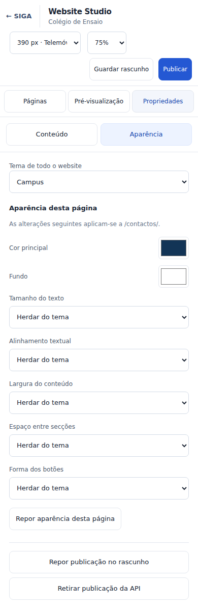

# Website Studio com Puck — execução e evidências

Data: 24/10/2026. Base: `main` em `42ad7eff`, com as correcções e documentação da
PR #275. Incremento de interface ainda sem integração nem produção.

## Implementação

- Rota privada `/website/editor`, layout próprio sem AppShell académico; mantém
  AuthGate, RouteAccessGate, TenantAccessBarrier e serviços existentes.
- Puck `@puckeditor/core@0.23.0`, MIT, integrado por composição: inspector de campos
  e preview do template existente. Não foi copiada uma aplicação demo completa.
- 56 páginas reais do manifesto; grupos obtidos das ligações efectivas do HTML.
  O inspector monta até 20 campos de cada vez e mantém pesquisa/paginação local.
- Conteúdo e aparência em painéis; tema global e controlos suportados por página.
  A validação de contraste conserva o rascunho e mostra erro sem quebrar o editor.
- Larguras 320/390/768/1024/1440/1920 e zoom 50/75/100, independentes da publicação
  e da resolução original das imagens. Vistas móveis Páginas/Prévia/Propriedades.
- Guardar, publicar, retirar e restaurar usam o contrato e revisão actuais.
  Nome académico ligado conserva a autoridade do curso; alterar a associação
  continua disponível nas configurações completas.
- `/configuracoes?painel=website` e a entrada Website do centro de Definições abrem
  o estúdio. `?painel=website.advanced` conserva todas as configurações anteriores;
  `?painel=website.blog` mantém o blog.

Não há novo schema, tabela, API pública de rascunhos ou armazenamento de JSON do
Puck. O adaptador só escreve campos do manifesto no `WebsiteDraft` existente.
A inserção/duplicação/remoção e o arrastar livre do Puck estão desactivados para
conservar a estrutura aprovada. A selecção directa do DOM está agora disponível num modo opcional, com a ponte
restrita descrita em [REFINEMENT.md](REFINEMENT.md). Continua sem arrastar livre.

## Segurança e continuidade

A rota não entrou na lista pública; é exclusiva de Administrador no módulo Gestão,
inclusive quando outro cargo tem grant Total. As guardas de escrita e AAL2 da
PR #275 continuam no servidor. Query por conta/escola, sem refetch automático por
foco/religação durante a edição, GC imediato ao sair e AbortSignal no carregamento.
Respostas antigas não são aplicadas na escola seguinte; respostas de escrita não
recriam a cache do estúdio depois do seu unmount.

O preview normal mantém `sandbox=""`, sem scripts/same-origin, e `referrerPolicy=no-referrer`.
O modo de selecção usa `allow-scripts` com CSP por nonce e sem same-origin, rede de
dados ou comandos de escrita; ver [protocolo e ensaios](REFINEMENT.md).
O Puck renderiza apenas componentes de confiança do SIGA; não executa componentes
fornecidos pela escola. A geração de HTML é adiada 220 ms depois da última edição,
conservando a última prévia válida se uma URL ainda estiver incompleta.

A biblioteca e o manifesto ficam na rota lazy. O ramo SSR elimina o import do
estúdio para não incluir Puck/Happy DOM no Worker. O CSS sem fontes externas do
Puck é carregado pelo módulo dedicado. Não foram alterados `painel/escolas/**`.

## Ensaios

| Verificação | Evidência / limite |
| --- | --- |
| Testes do módulo, acesso, configuração e orçamento inicial | 43 ficheiros e 343 testes passaram; inclui Puck real, não apenas um mock de inspector |
| Tipos e build | Typecheck passou; build de produção Node passou; instalação com lockfile congelado passou |
| Lint e estilo | ESLint global: 0 erros e 47 avisos; checklist de estilo passou (974 ficheiros) |
| Cancelamento A/B | Leitura de A abortada; resposta atrasada de A não aparece em B; fixture React Query |
| Browser com biblioteca real | [browser-results.json](browser-results.json): editar/guardar/publicar, falha que conserva rascunho, saída cancelada, página, zoom e aparência |
| Responsividade | Seis larguras sem overflow horizontal e sem erros JavaScript no ensaio |
| Backend real | Não ensaiado: os comandos do browser usam fixtures locais |
| Desempenho | [performance.json](performance.json): pré-carga da raiz e separação do módulo; não é medição de rede real ou p75 |
| Produção / Cloudflare / MFA real | Não executados; dependem do staging/canário autorizado |

A amostra inicial de feedback no browser inclui a automação e a espera pelo estado
visual; não é INP p75. Não atribuir melhoria percentual de latência à diferença de
bytes do manifesto. Contagens são de recursos sem compressão e não incluem a soma
de todos os pedidos de todas as rotas.




## Reproduzir

```sh
bun install --frozen-lockfile
npx vitest run tests/school-website/ tests/auth/access-policy.test.ts tests/security/module-grant-enforcement.test.ts tests/routes/configuracoes.test.tsx tests/ui/stacked-settings.test.tsx tests/ui/first-paint-budget.test.ts --fileParallelism=false
npm run typecheck
npm run lint
SIGA_NITRO_PRESET=node-server npm run build
node tests/qa/website-studio/measure.mjs
npx playwright install chromium
node tests/qa/website-studio/run.mjs
```

A medição aceita opcionalmente o caminho de um manifesto resumido anterior, gerado
com o mesmo método. O JSON entregue conserva a comparação realmente observada;
executar sem baseline não inventa uma medição anterior.

O harness usa um Vite independente em localhost, Puck real e dados fictícios.
Substitui os módulos de conta/servidor apenas nessa configuração QA; chamadas
inesperadas ao backend falham. Não é rota da aplicação nem é copiado para o build
público; o medidor verifica a ausência de `tests/qa` na saída. A primeira tentativa
com Chrome completo falhou por uma restrição de socket do ambiente; o ensaio
final utilizou o Chromium Headless Shell normal do Playwright.

## Dependências e promoção

Happy DOM transitivo fica fixado em 21.0.4 por override, após a auditoria identificar
um aviso alto na versão transitiva anterior. Puck continua fixo em 0.23.0, com
lockfile. [Licença upstream preservada](../../school-sites/PUCK_LICENSE.txt), também
incluída na distribuição estática em `/licenses/puck.txt`.

A auditoria inicial encontrou alertas em body-parser, Undici e Zod. O refinamento
actualiza body-parser e Undici por overrides compatíveis, restando o Zod. A saída
original abaixo conserva a evidência histórica; o novo relatório está em
[dependency-audit-refinement.txt](dependency-audit-refinement.txt). Não há exclusão
de alertas nem upgrade major forçado. [Comparativo de auditoria](dependency-audit.txt): saída idêntica na base e neste incremento.
Manter em revisão até CI, compatibilidade de dependências e ensaio real Admin+AAL2,
A/B e domínio canário. Não houve SQL, DNS ou deployment de produção.
