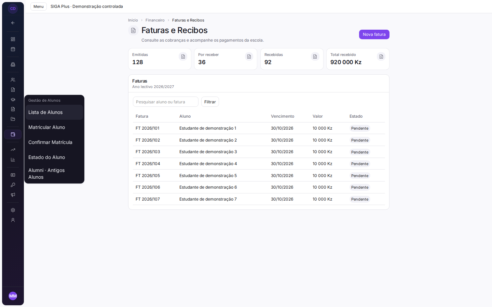

# Refinamento visual e navegação contextual

Base: `82b5bdc3` (main). Referência de organização: [Atlassian Navigation System](https://atlassian.design/components/navigation-system/). Adaptação aos componentes e permissões do SIGA; sem instalar Atlaskit.

## Alterações

| Área | Antes | Depois | Evidência |
| --- | --- | --- | --- |
| Sidebar | Grupos globais e submenus acumulados em armazenamento local | Contexto derivado do catálogo autorizado; Todas as áreas/Voltar ao módulo; um submenu global aberto por vez | `tests/routes/sidebar-nav.test.tsx` |
| Académico | Árvore académica montada também no financeiro | Árvore apresentada no contexto pedagógico | Condição em `AppSidebar.tsx`; árvore e APIs preservadas |
| Destino activo | Listagem genérica e acção específica podiam aparecer seleccionadas simultaneamente | Parâmetros específicos têm prioridade; links sem estado explícito conservam o comportamento do router | `tests/auth/contextual-navigation.test.ts` |
| Cabeçalhos e estatísticas | Ícones primários e sombras por omissão | Ícones neutros e hierarquia mais discreta; tons de estado explícitos preservados | `PageHeader.tsx` |
| Painéis e cartões | Sombras, elevação ao hover e cantos maiores | Superfícies com bordas subtis, sem elevação decorativa | `PageHeader.tsx`, `card.tsx` |

Catálogo, ordem dos destinos, rotas, grants, plano, RBAC, autenticação, APIs e base de dados não foram alterados. A navegação usa apenas o resultado já filtrado de `getPortalNavigation`. Continua disponível a navegação mobile própria do AppShell. A preferência de recolher a sidebar mantém-se.

## Comparação visual

Capturas de componentes reais (`AppSidebar`, `PageHeader`, `StatGrid`, `Panel`) num cenário controlado de Faturas e Recibos. Escola, pessoa, valores e registos são fictícios. Conta, sessão, router e fronteiras de rede foram substituídos no ensaio; não são capturas de uma escola autenticada nem prova de funcionamento financeiro.

| Tamanho | Antes | Depois |
| --- | --- | --- |
| Desktop 1440 × 900 | [Antes](before-1440.png) | [Depois](after-1440.png) |
| Tablet 834 × 900 | [Antes](before-834.png) | [Depois](after-834.png) |
| Telemóvel 390 × 900 | [Antes](before-390.png) | [Depois](after-390.png) |

A composição de demonstração em tablet/telemóvel verifica os componentes partilhados, não o AppShell mobile autenticado. Captura adicional: [sidebar recolhida](after-collapsed.png).

## Validação e limites

- Ronda final: 49 testes em nove ficheiros aprovados (navegação, sidebar, apresentação, ausência de ciclo de render e repetição de dois ficheiros da suite global). O terceiro ficheiro repetido, `tests/enrollment/public-review-flow.test.tsx`, passou com dois testes: 51 testes nesta ronda final.
- Chromium headless: seis capturas (antes/depois em 1440/834/390 px), sem erros JavaScript nem transbordo horizontal do documento. Alternância Todas as áreas/Voltar ao módulo e recolher a sidebar exercitadas. Inter local servido no ensaio.
- ESLint dos ficheiros alterados: sem erros; avisos de Fast Refresh nos módulos que também exportam constantes.
- `npm run build`: build final de cliente, SSR e Nitro Cloudflare concluído com código 0.
- TypeScript global inconclusivo: primeira execução esgotou o heap padrão de 2 GB; a tentativa limitada com heap de 5 GB não terminou em 180 segundos (código 124). Não equivale a aprovação de tipos.
- Suite completa (`vitest run --maxWorkers=4`): 4048 aprovados, 19 ignorados e três falhas em 596 ficheiros (590 aprovados, três ignorados e três falhados). Os três ficheiros afectados passaram na repetição isolada com um worker e orçamento de 20 segundos por teste. Não se declara uma execução única da suite completamente verde.

Pendente: sessão real, permissões dinâmicas entre escolas, dispositivos físicos, teclado/zoom e auditoria de todos os módulos e formulários extensos. Não houve deploy nem migrações de produção.

## Continuação — teclado na sidebar recolhida

Os antigos painéis por hover ficavam dentro de um ancestral com `overflow-hidden`.
Foram substituídos pelo `DropdownMenu` já existente, com portal: os submenus deixam
de ser cortados, abrem por Enter/setas, fecham por Escape e devolvem o foco ao
botão. Os destinos e parâmetros continuam a vir do catálogo autorizado.

Validação deste incremento:

- 44 testes aprovados em seis ficheiros, incluindo abertura num portal, preservação
  de `?action=matricular` e fecho por Escape. O mock do Link passa agora os eventos,
  atributos e a referência de foco ao elemento real, como o componente de produção.
- Chromium no cenário controlado: Enter abre o menu, seta move o foco para
  «Matricular Aluno», Escape fecha e devolve o foco ao botão. A caixa do menu fica
  dentro da viewport e fora da área de corte da sidebar. As seis capturas
  responsivas repetidas mantêm zero erros JavaScript e zero transbordo do documento.
- API do compilador TypeScript, com a configuração real do projecto: diagnósticos
  sintácticos e semânticos dos sete ficheiros de código/testes desta PR = **0**.
  Esta verificação é dirigida; não equivale a aprovação global.
- O `tsc --noEmit --extendedDiagnostics` global voltou a atingir 240 segundos sem
  conclusão. Um trace de 90 segundos mostrou a verificação a prosseguir por módulos
  como `advanced-academic-server.ts`. Não foi alterada a configuração do compilador,
  nem foram ocultados erros ou excluídos ficheiros do projecto.
- `npm run build`: cliente, SSR e Nitro Cloudflare concluídos com código 0.
- ESLint dos dois ficheiros alterados neste incremento: código 0, sem erros ou avisos.

A revisão autenticada e a verificação global continuam pendentes. Sem deploy.

## Continuação — cabeçalhos e contexto por perfil

- O breadcrumb por omissão deixa de repetir o grupo quando coincide com o título
  (incluindo diferenças de espaços e maiúsculas), e omite grupos vazios.
- Só a última entrada recebe `aria-current="page"`. Grupos sem destino são texto
  de contexto; breadcrumbs explícitos mantêm caminhos e parâmetros.
- Descrições vazias deixam de acrescentar um parágrafo e margem ao cabeçalho.
- «Configurações da Escola» no menu institucional usa a política existente para
  aparecer apenas a quem pode abrir a área; o backend não foi alterado.
- Testes de rerender confirmam que uma pesquisa equivalente conserva a escolha de
  áreas; mudar de escola repõe o contexto; mudar para Aluno retira áreas administrativas.

Validação: 55 testes aprovados em sete ficheiros; diagnóstico sintáctico e semântico
com a API TypeScript dos oito ficheiros de código/testes da PR = zero. Os testes do
cabeçalho renderizam o componente real, substituindo o teste antigo que reproduzia
uma lista de breadcrumbs sem exercitar a interface. As capturas controladas em
1440/834/390 px foram repetidas sem erros JavaScript ou transbordo do documento;
Enter/setas/Escape e retorno do foco mantêm-se aprovados. ESLint sem erros (aviso
preexistente de Fast Refresh em `PageHeader.tsx`). Build final do cliente, SSR e Nitro Cloudflare concluído com código 0.

Continuam pendentes a revisão autenticada e o `tsc` global. Sem merge ou deploy.

## Continuação — indicadores e filtros discretos

- `StatCard` usa tom neutro por omissão, sem sombras decorativas; tons explícitos
  de aviso, erro, sucesso e informação permanecem. Rótulos e valores longos podem
  quebrar linha, e a tendência pode passar para a linha seguinte sem sobreposição.
- A barra de filtros usa o mesmo raio discreto dos cartões. Os botões dos filtros
  activos têm nomes acessíveis que explicam qual o filtro a remover. A pesquisa
  usa o seu rótulo como nome acessível, preservando o placeholder e o debounce.
- Estatísticas recolhidas mantêm o estado dos filhos mas usam `inert`, impedindo
  foco nos controlos invisíveis. O botão referencia a região com `aria-controls`;
  as transições respeitam movimento reduzido.

Validação: 41 testes de componentes/contratos mais 18 testes das páginas de início,
alunos, financeiro e portais aprovados (59 em dez ficheiros). Diagnósticos sintácticos
e semânticos dirigidos aos 12 ficheiros de código/testes desta PR = zero.

Chromium, ensaio controlado em 1440/390 px: Tab ignora a acção oculta, a acção fica
acessível ao expandir e o filtro escolhido é removido sem alterar os restantes.
Sem transbordo horizontal do documento. Capturas de componentes reais com valores
de demonstração, não de uma sessão escolar autenticada:
[desktop](list-controls-desktop.png) e [telemóvel](list-controls-mobile.png).

Build final do cliente, SSR e Nitro Cloudflare aprovado (código 0); ESLint sem erros, com um aviso preexistente de Fast Refresh. Não houve alterações de APIs,
regras financeiras/académicas, permissões ou base de dados. O `tsc` global e a
revisão autenticada continuam pendentes; sem merge ou deploy.

## Continuação — compatibilidade para ligar o novo visual

Foram documentados os [pontos de integração](../../design/CONTEXTUAL_VISUAL_INTEGRATION.md)
para o trabalho do outro agente, com as camadas de aparência, componentes partilhados
e comportamentos de navegação a preservar. A branch/PR ou imagens desse trabalho
ainda não foram identificadas: a integração com esse visual não está concluída.

Validação deste incremento: 26 testes aprovados em quatro ficheiros, incluindo dois
casos novos com a sidebar real e `applyAppearance`. Alternar claro/escuro e densidade
preserva a escolha de áreas e os destinos, com presets de sidebar claro e tinta.
São testes de comportamento em jsdom, sem medição de contraste ou nova comparação
visual. ESLint do teste alterado sem erros/avisos e zero diagnósticos TypeScript
dirigidos aos mesmos 12 ficheiros. Não houve alteração do código de produção;
o build aprovado no incremento anterior não foi repetido. Sem merge ou deploy.

## Continuação — modais com textos e formulários longos

`Dialog` e `AlertDialog` partilhados passam a ter títulos e descrições que quebram
referências longas, acções com quebra de texto e espaçamento uniforme. O cabeçalho
do diálogo reserva espaço para fechar; títulos em várias linhas deixam de usar
entrelinha compactada. No diálogo de formulário, o conteúdo usa `min-w-0` e
`overscroll-contain`. A confirmação mantém o seu comportamento próprio de Radix;
não foram alteradas as regras de confirmação, descarte ou submissão.

| Cenário controlado | Antes | Depois |
| --- | --- | --- |
| Formulário, desktop 1440 px | [Antes](dialog-before-1440.png) | [Depois](dialog-after-1440.png) |
| Formulário, telemóvel 390 px | [Antes](dialog-before-390.png) | [Depois](dialog-after-390.png) |
| Acções após deslocação, 390 × 420 px | [Antes](dialog-footer-before-390.png) | [Depois](dialog-footer-after-390.png) |
| Confirmação, telemóvel 390 px | [Antes](alert-before-390.png) | [Depois](alert-after-390.png) |

As capturas usam os componentes reais e dados fictícios, incluindo nome comprido,
referência sem espaços, oito campos e rótulos de acção extensos. O caso limite
reproduz transbordo horizontal em ambos os modais anteriores e acção cortada no
formulário mobile. Após a alteração, os dois modais não transbordam nas dimensões
1440 × 900, 834 × 900, 390 × 900, 320 × 568 e 390 × 420 px. A acção do formulário
fica dentro da viewport depois de deslocar o conteúdo. Submissão de demonstração,
Escape, retorno do foco e cancelamento da confirmação foram exercitados.
[Resultados medidos](dialog-results.json).

Os 13 testes existentes de `modal-shell`, `modal-system` e `wizard-modal` passaram,
incluindo protecção de alterações não guardadas e confirmação de descarte. ESLint
dos dois ficheiros alterados sem erros/avisos. O ensaio Chromium não substitui a
verificação em dispositivos físicos, teclado virtual ou sessão escolar autenticada.

Diagnósticos sintácticos e semânticos TypeScript dirigidos aos 14 ficheiros de
código/testes da PR = zero; o `tsc` global continua pendente. Build final de cliente,
SSR e Nitro Cloudflare concluído com código 0. Sem merge, deploy ou alterações de dados.
