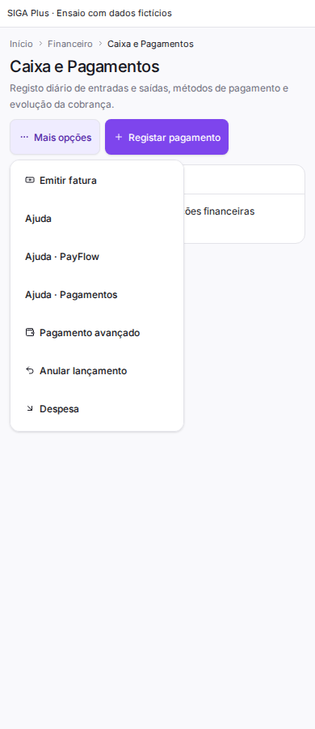
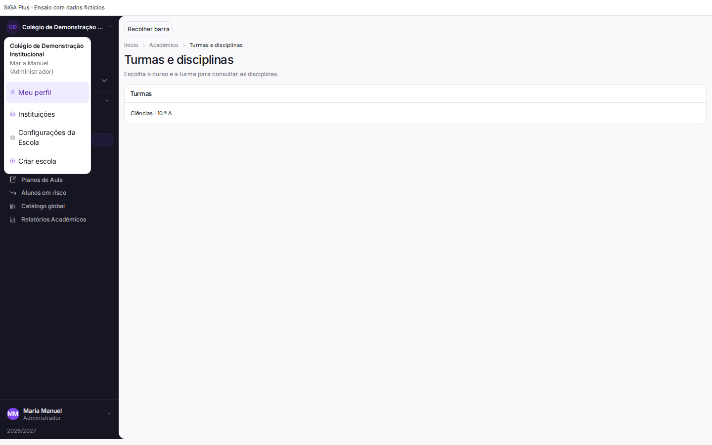
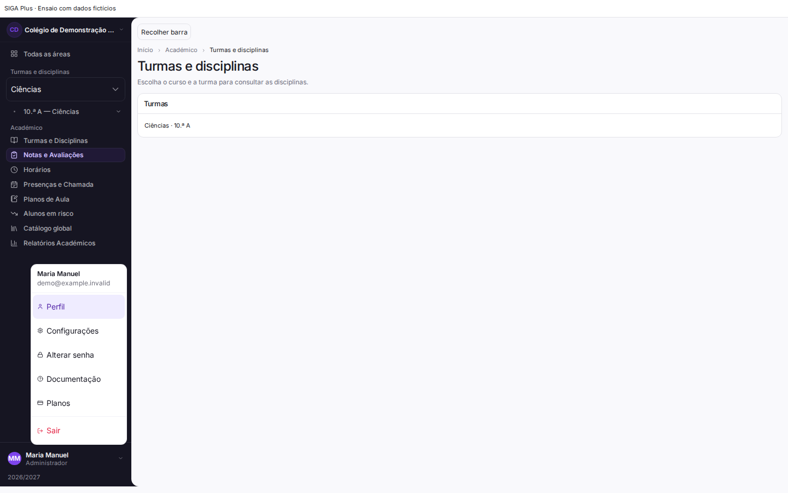
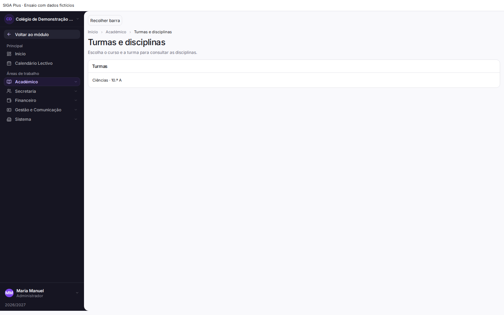
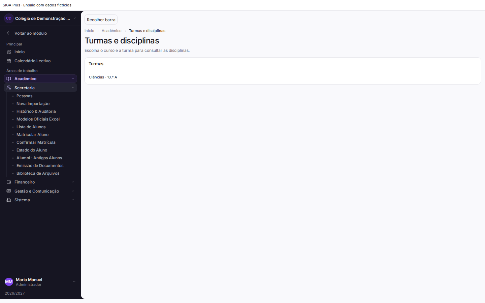
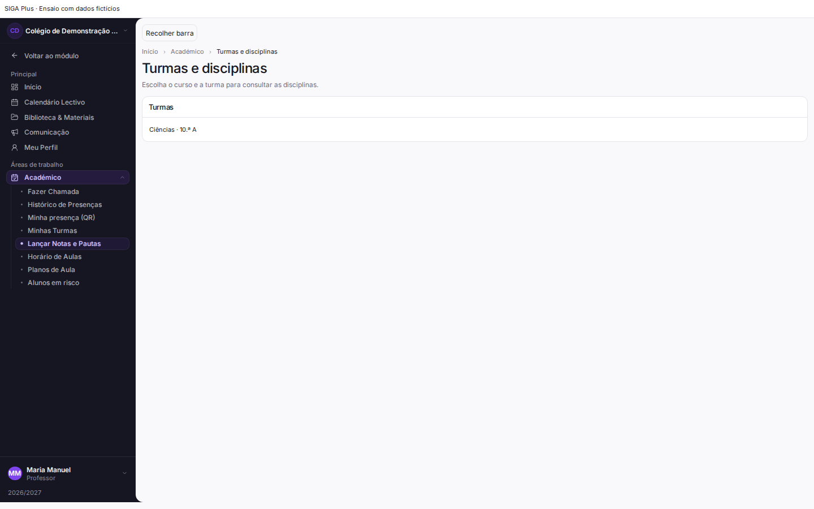

# Correcções dos desvios ao spec visual — 23/10/2026

Os oito desvios identificados na auditoria foram corrigidos no código existente. A referência de navegação é o [Atlassian Design System](https://atlassian.design/components/navigation-system/); a identidade e os componentes do SIGA foram conservados. Esta entrega distingue implementação, ensaio representativo e funcionamento autenticado ainda por verificar.

Base visual anterior: `a078327bc354a28a6b8c991f3a24ec721331bb04`. A implementação incorpora também `ecc31fe790cefd895e79457f2aa4fb586bbce32e`, incluindo a melhoria de acessibilidade da recuperação de palavra-passe feita noutra frente.

| Desvio | Correcção implementada | Evidência |
| --- | --- | --- |
| Árvore académica com três níveis | Curso/nível passa a selector de contexto; a árvore contém apenas turma e disciplina. Pauta do primário e parâmetros das disciplinas preservados. Turma secundária sem disciplinas apresenta estado vazio. | Testes do componente real, troca de curso e destino no navegador |
| Flyout académico cortado na barra recolhida | Popover Radix em portal, com altura limitada, deslocamento, Escape e retorno do foco. | Painel fora do `aside`, dentro do viewport e destino conservado |
| Menu móvel com todos os submenus e escola ausente nas páginas internas | Gaveta abre no módulo activo; “Todas as áreas” permite mudar de contexto. Escola e módulo aparecem no cabeçalho interno. A selecção de página fecha a gaveta. | 320, 390 e 834 px; contexto activo e parâmetros de matrícula verificados |
| Excesso de acções nos cabeçalhos reais | Financeiro, Calendário e Comunicações conservam a acção principal; operações ocasionais ficam em `PageActionMenu`. Os formulários permanecem montados para conservar rascunhos. | Financeiro: 16 controlos expostos antes, 2 depois; testes das três rotas |
| Gradientes decorativos | Removido o gradiente da sidebar e simplificado o cabeçalho Alumni, sem remover dados ou fotografia. | CSS medido da sidebar: `linear-gradient(...)` → `none`; revisão do código Alumni |
| Texto demasiado pequeno na navegação | Rótulos comuns e secundários usam a escala tipográfica existente, com mínimo de 12 px. | Disciplina: 7,5625 px antes → 12 px depois |
| Relatórios fora do módulo | Financeiro e Académico incluem os respectivos relatórios existentes no contexto, apenas quando presentes no catálogo já filtrado por autorização. | Testes de contexto, incluindo relatório não autorizado ausente |
| Linguagem técnica no calendário | “Subscrever calendário”, “Modelos” e instruções de período em linguagem corrente. Avisos e validações operacionais conservados. | Revisão de código e testes das rotas |

A verificação visual encontrou ainda duas causas de corte nas opções: a contenção de pintura no `main` e o alinhamento à direita em ecrãs estreitos. A contenção foi removida do layout comum e o menu alinha à esquerda no mobile e à direita no desktop. A primeira e a última opção são atingíveis e o painel fica inteiramente dentro do viewport nos quatro tamanhos ensaiados.

## Antes/depois

As imagens usam os componentes reais, incluindo `AcademicNavTree`, `AppSidebar`, `MoreHub` e `MobileHeader`. O cabeçalho Financeiro é extraído do JSX da rota real, com os seus controlos. Conta, router, queries, rede e integrações de documentos/PayFlow são controlados pelo ensaio. O conteúdo principal financeiro é representativo e as submissões estão desactivadas. Estas imagens não são capturas de uma sessão autenticada em produção.

### Académico, desktop

| Antes | Depois |
| --- | --- |
|  |  |
|  |  |

### Navegação móvel, 390 px

| Antes | Depois |
| --- | --- |
|  |  |

### Cabeçalho Financeiro real

| Antes | Depois |
| --- | --- |
|  |  |
|  |  |

## Componentes alterados

- Layout: `AcademicNavTree`, `AppShell`, `NavItem`, `PageHeader` e novo `PageActionMenu`.
- Mobile: `MobileHeader`, `MoreHub`; contexto comum em `contextual-navigation.ts`.
- Rotas: Financeiro, Calendário, Comunicações e perfil Alumni; estilos comuns da sidebar.
- Testes: contexto autorizado, cabeçalho móvel, árvore académica real, gaveta contextual real e persistência/teclado do menu de acções.

Nenhuma dependência de produção foi acrescentada. Não houve alteração de schema, backend, políticas de autorização ou regras de negócio. Os atalhos continuam a usar os destinos e parâmetros existentes. A autorização das rotas e do backend continua a ser necessária.

## Validação efectuada

- 77 testes passaram em 10 ficheiros seleccionados, cobrindo os componentes alterados e as rotas Financeiro, Calendário e Comunicações.
- Verificação TypeScript dirigida a 17 ficheiros alterados: zero diagnósticos. Não representa aprovação do TypeScript global do repositório.
- ESLint dirigido: zero erros; dois avisos de Fast Refresh já existentes em `NavItem` e `PageHeader`.
- Build de produção concluído com código de saída zero.
- Comparação AST dos atributos `onSubmit`, `onClick`, `disabled` e `fields`: 27 contratos Financeiro, 41 Calendário e 24 Comunicações preservados. Isto verifica o código, não executa operações financeiras.
- 16 cenários de navegador antes/depois. No estado corrigido: sem erros JavaScript ou overflow horizontal; popover académico sem corte; curso, turma e disciplina correctos; gaveta fecha ao navegar; destaque activo; menu financeiro dentro do ecrã; primeira/última opção atingíveis; Escape e foco após fechar modal verificados.
- Testes controlados com Administrador, Professor, Aluno e Utilizador; mudança de escola e ausência de autorização. Registo detalhado em [browser-results.json](browser-results.json).

## Verificação ainda pendente

É necessário confirmar numa sessão autenticada os perfis e permissões reais, o isolamento entre escolas e os fluxos completos de pagamentos, notas e comunicações. Não foram efectuadas submissões reais, testes em dispositivos físicos, avaliação com leitor de ecrã, teclado virtual ou auditoria formal de contraste/zoom. Volumes grandes de registos e formulários extensos exigem validação com dados representativos de cada escola. Não se declara a suite global nem o TypeScript global aprovados.

## Ajuste adicional: contorno da sidebar

O lado esquerdo ficou recto e encostado à margem do ecrã. Na junção com o conteúdo, o fundo da sidebar envolve os cantos esquerdos arredondados da superfície principal, formando curvas côncavas superior e inferior. Não há intervalo entre as duas superfícies. O efeito usa as superfícies existentes e aplica-se apenas à composição desktop; o menu móvel conserva a sua gaveta.

Verificação representativa no navegador a 1024 e 1440 px, aberta e recolhida: sidebar na coordenada x=0, junção contínua, quatro cantos próprios a 0 px, curvas da superfície principal presentes e nenhum overflow horizontal. Componentes de navegação reais; conta e rede controladas, como no ensaio anterior. Dados em [sidebar-shape-browser.json](sidebar-shape-browser.json).

## Verificação de prontidão para publicação

O CI remoto do commit `fe1c5365` detectou TS2322 em `flattenNavigationGroup`: a inferência de `flatMap` não aceitava simultaneamente destinos e grupos. Corrigido com o tipo explícito do item do catálogo; sem mudança de comportamento. A verificação TypeScript dirigida registada acima não detectou este erro e não substitui o CI global.

Na consulta ao GitHub, o PR #252 permanecia aberto e a publicação de produção aprovada correspondia a `ecc31fe7`, anterior a este refinamento. Não há neste ambiente credenciais/sessão autenticada nem staging configurado para validar fluxos completos por escola. O ensaio automatizado com escrita existente recusa produção e exige staging isolado. A validação física de Android/iOS e restantes dispositivos continua pendente.

## Refinamento da pesquisa e das acções

A pesquisa da gaveta encontra nomes de áreas e páginas sem exigir acentos ou distinção de maiúsculas. Por exemplo, `relatorios` encontra “Relatórios Académicos” e `FINANCEIRO` encontra as secções financeiras autorizadas. Limpar a pesquisa repõe o contexto actual; pesquisar uma área não concede destinos fora do perfil. O rótulo passou a “Procurar página ou área”.

O painel “Mais opções” usa linhas discretas, sem bordas e sombras em cada botão, mantendo a área de toque, o foco, os formulários e os estados desactivados.

Validação desta iteração: 37 testes em sete ficheiros e ESLint dos ficheiros alterados sem erros. Repetidos 16 cenários representativos antes/depois no navegador, com painel dentro do viewport a 320/390/834/1440 px, acesso à última opção e retorno de foco do modal. Permanecem as limitações de sessão real e dispositivos físicos descritas acima.

No CI de `6884d3f`, o TypeScript global passou e a suite teve 4108 testes aprovados, 19 ignorados e dois falhados. Os dois testes ainda exigiam `text-xs` e `0.6875rem`, o padrão pequeno substituído nesta revisão. Foram actualizados para proteger a escala legível; o novo resultado global será determinado pelo CI seguinte.

## Refinamento de identidade e nomes longos

Os menus da escola e da conta permitem ler os nomes completos; o email quebra linha quando necessário. O botão da escola possui um rótulo explícito também na sidebar recolhida. Os itens de troca de escola têm alvo mínimo de 44 px. Curso e destinos truncados conservam o nome completo no atributo `title`. Os textos “Minha Conta / Perfil” e “Criar escola (WEB)” passam a “Meu perfil” e “Criar escola”, com os mesmos destinos e regras.

Validação desta iteração: 26 testes em três ficheiros, incluindo abertura por teclado do selector da escola e retorno do foco após Escape com a barra aberta/recolhida; ESLint sem erros (um aviso de Fast Refresh existente em NavItem). Seis cenários representativos no navegador a 1024/1440 px: menus da escola, da conta e da escola com barra recolhida, sem cortes e com foco restaurado. Registo em [refined-school-results.json](refined-school-results.json). Fronteiras de conta e rede controladas, sem alternância real de escola.

O CI do commit anterior `7e52070c` passou: TypeScript global, lint, build e 4113 testes aprovados, 19 ignorados. Este resultado refere-se à versão anterior a este último refinamento; o novo commit requer o seu próprio CI.

## Organização das áreas e lógica de contexto

A visão geral do desktop apresenta as áreas autorizadas, com apenas uma expandida de cada vez. A navegação contextual da Secretaria mantém alunos, pessoas, importações, documentos e arquivos na mesma ordem, sem mudar de menu a cada secção. Nos portais de Aluno, Encarregado e Professor, os destinos académicos e de frequência ficam reunidos em “Académico”; Financeiro mantém o seu próprio contexto. O perfil pessoal abre apenas o seu contexto, sem misturar definições da escola.

`getNavigationAreas` fornece a mesma organização para a sidebar, a gaveta e a pesquisa. Os relatórios financeiros e académicos ficam numa única área correspondente; se a área não estiver autorizada mas o relatório estiver no catálogo, este continua acessível em Relatórios. Não há introdução de destinos, alteração dos parâmetros ou substituição da autorização das rotas/backend. Um teste compara todos os destinos e parâmetros antes/depois da organização.

Corrigido também o fecho do menu recolhido após seleccionar um link cuja navegação é interceptada pelo router. O teste reproduz `preventDefault`, sem depender do comportamento de navegação normal do browser.

Validação: 77 testes em seis ficheiros passaram; ESLint dirigido sem erros. Os 16 cenários representativos de navegação/visual anteriores foram repetidos com sucesso, e dois ensaios adicionais a 1024/1440 px confirmaram apenas uma área expandida, relatórios no módulo, navegação por teclado com a barra recolhida, fecho após selecção, parâmetro de matrícula preservado e ausência de overflow. Registo em [organized-navigation-results.json](organized-navigation-results.json). O TypeScript local global abortou com saída 134 neste ambiente; não é declarado aprovado para esta iteração. O CI anterior `cca74abee` estava aprovado, e o novo commit requer a sua própria execução.

## Áreas consistentes nos portais e correcção dos tipos

A visão geral de Aluno, Encarregado e Professor passa a usar as mesmas áreas que o contexto: Académico e Financeiro, conforme os destinos já autorizados. Os atalhos gerais, incluindo Calendário Lectivo, continuam directos e não exigem abrir uma área intermédia. A pesquisa por `academico` encontra notas e frequência nesses portais. A comparação de destinos e parâmetros cobre agora os três perfis.

O CI de `069b1ba2` detectou que os filhos dos novos agrupamentos tinham o tipo genérico `NavItem[]`, que permite destinos ausentes, em vez de `NavChild[]`. A organização plana agora declara `NavigationArea` com destinos concretos e só emite folhas navegáveis, e os grupos da sidebar têm o contrato `NavGroup[]` explícito. Corrigida também a inferência de `flatMap` no teste de preservação de destinos.

Nesta iteração passaram 82 testes em seis ficheiros e o ESLint dirigido. Seis cenários de navegador com os componentes reais, fronteiras de conta/rede controladas e perfis Aluno, Encarregado e Professor a 390/1440 px confirmaram área académica comum, calendário directo, ausência de atalhos administrativos, parâmetros de frequência/chamada preservados, gaveta mobile fechada após selecção e ausência de overflow. Dados em [portal-areas-browser-results.json](portal-areas-browser-results.json).

O ambiente local foi interrompido durante a verificação TypeScript global e recuperou depois. Os testes e as capturas foram confirmados após a recuperação; o TypeScript global desta iteração depende do CI seguinte. Não se trata de uma sessão real autenticada nem de validação em dispositivo físico.

