# Correcções dos desvios ao spec visual — 23/10/2026

Os oito desvios identificados na auditoria foram corrigidos no código existente. A referência de navegação é o [Atlassian Design System](https://atlassian.design/components/navigation-system/); a identidade e os componentes do SIGA foram conservados. Esta entrega distingue implementação, ensaio representativo e funcionamento autenticado ainda por verificar.

Base visual anterior: `a078327bc354a28a6b8c991f3a24ec721331bb04`. A implementação incorpora também `ecc31fe790cefd895e79457f2aa4fb586bbce32e`, incluindo a melhoria de acessibilidade da recuperação de palavra-passe feita noutra frente.

| Desvio | Correcção implementada | Evidência |
| --- | --- | --- |
| Árvore académica com três níveis | Curso/nível passa a selector de contexto; a árvore contém apenas turma e disciplina. Pauta do primário e parâmetros das disciplinas preservados. Turma secundária sem disciplinas apresenta estado vazio. | Testes do componente real, troca de curso e destino no navegador |
| Flyout académico cortado na barra recolhida | Popover Radix em portal, com altura limitada, deslocamento, Escape e retorno do foco. | Painel fora do `aside`, dentro do viewport e destino conservado |
| Menu móvel com todos os submenus e escola ausente nas páginas internas | Gaveta abre no módulo activo; “Todas as áreas” permite mudar de contexto. Escola e módulo aparecem no cabeçalho interno. A selecção de página fecha a gaveta. | 320, 390 e 834 px; contexto activo e parâmetros de matrícula verificados |
| Excesso de acções nos cabeçalhos reais | Financeiro, Calendário e Comunicações conservam a acção principal; operações ocasionais ficam em `PageActionMenu`. Os formulários permanecem montados para conservar rascunhos. | Financeiro: 16 controlos expostos antes, 2 depois; testes das três rotas |
| Gradientes decorativos | Removido o gradiente da sidebar e simplificado o cabeçalho Alumni, sem remover dados ou fotografia. | CSS medido da sidebar: `linear-gradient(...)` → `none`; revisão do código Alumni |
| Texto demasiado pequeno na navegação | Rótulos comuns e secundários usam a escala tipográfica existente, com mínimo de 12 px. | Disciplina: 7,5625 px antes → 12 px depois |
| Relatórios fora do módulo | Financeiro e Académico incluem os respectivos relatórios existentes no contexto, apenas quando presentes no catálogo já filtrado por autorização. | Testes de contexto, incluindo relatório não autorizado ausente |
| Linguagem técnica no calendário | “Subscrever calendário”, “Modelos” e instruções de período em linguagem corrente. Avisos e validações operacionais conservados. | Revisão de código e testes das rotas |

A verificação visual encontrou ainda duas causas de corte nas opções: a contenção de pintura no `main` e o alinhamento à direita em ecrãs estreitos. A contenção foi removida do layout comum e o menu alinha à esquerda no mobile e à direita no desktop. A primeira e a última opção são atingíveis e o painel fica inteiramente dentro do viewport nos quatro tamanhos ensaiados.

## Antes/depois

As imagens usam os componentes reais, incluindo `AcademicNavTree`, `AppSidebar`, `MoreHub` e `MobileHeader`. O cabeçalho Financeiro é extraído do JSX da rota real, com os seus controlos. Conta, router, queries, rede e integrações de documentos/PayFlow são controlados pelo ensaio. O conteúdo principal financeiro é representativo e as submissões estão desactivadas. Estas imagens não são capturas de uma sessão autenticada em produção.

### Académico, desktop

| Antes | Depois |
| --- | --- |
| 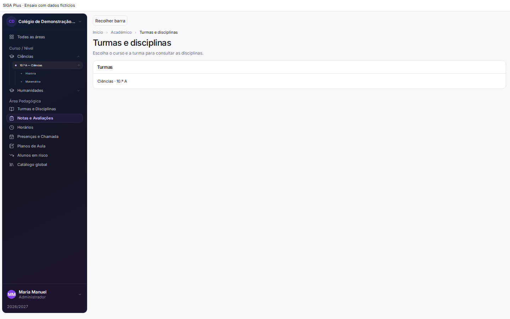 | 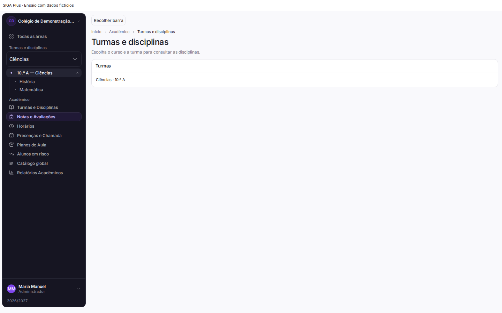 |
| 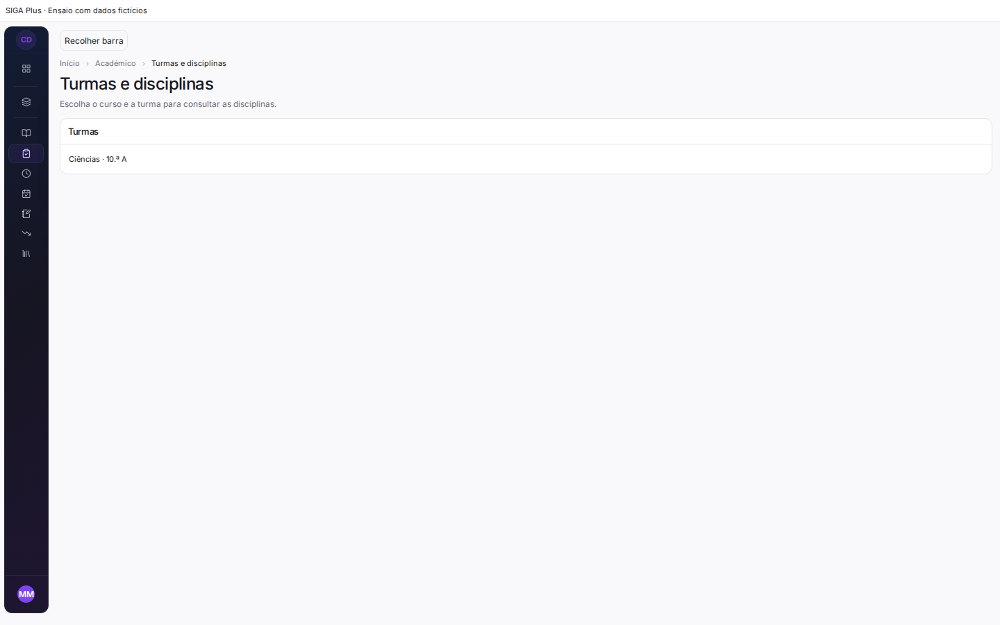 | 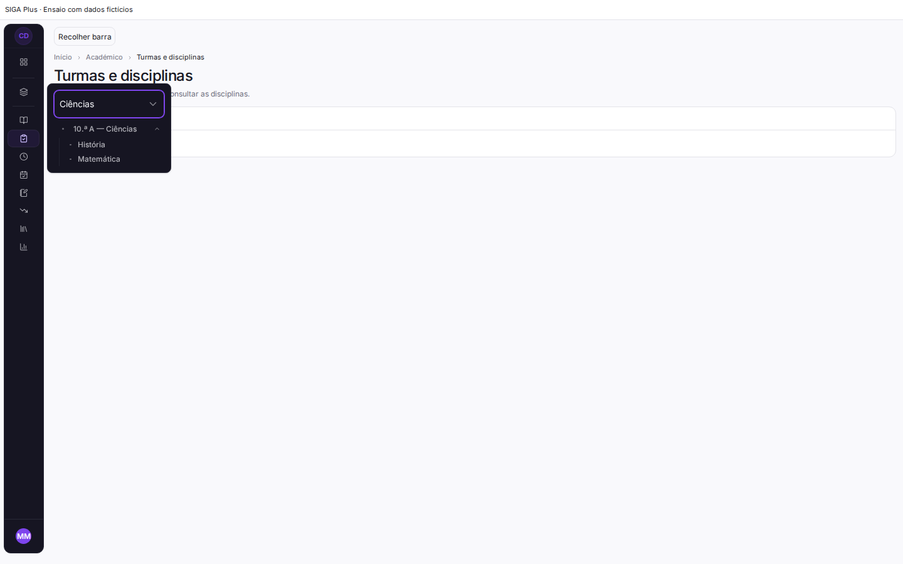 |

### Navegação móvel, 390 px

| Antes | Depois |
| --- | --- |
| 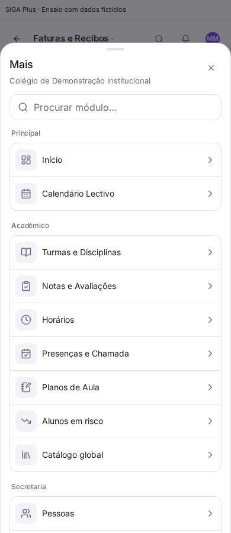 |  |

### Cabeçalho Financeiro real

| Antes | Depois |
| --- | --- |
| 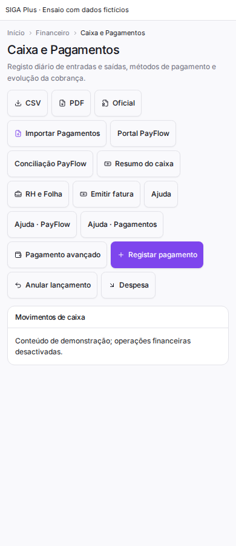 | 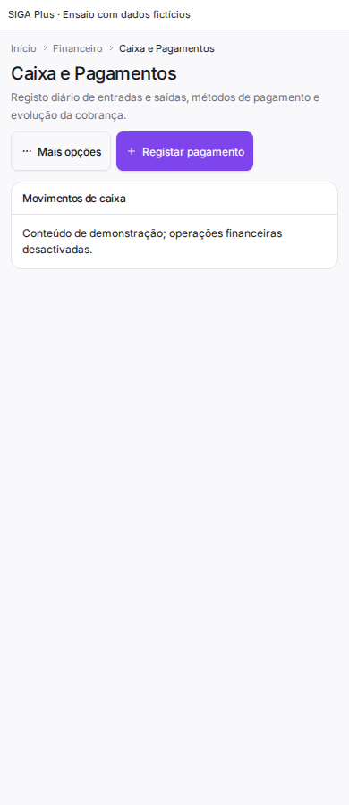 |
| 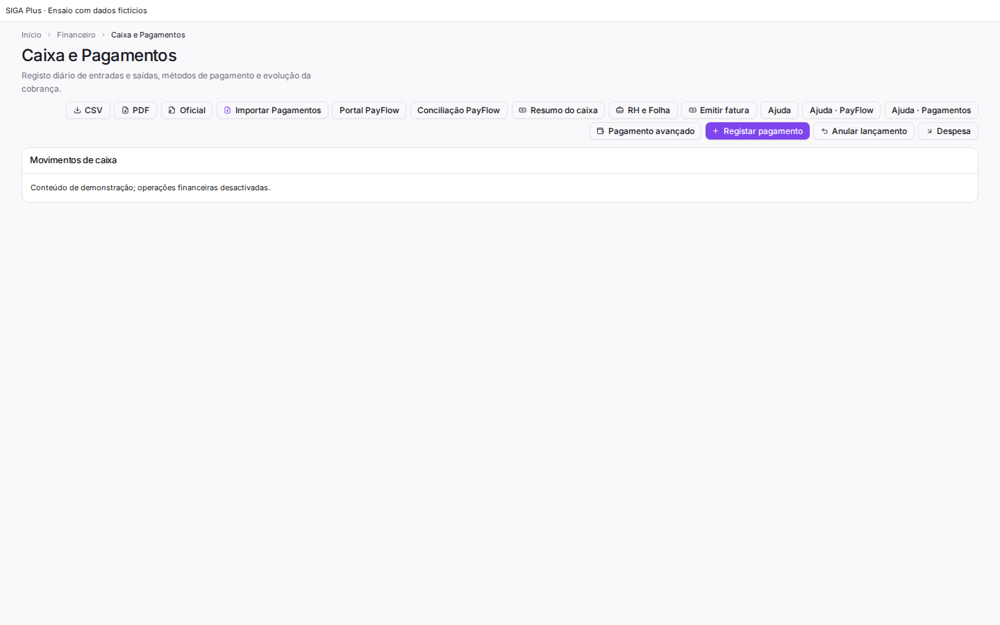 | 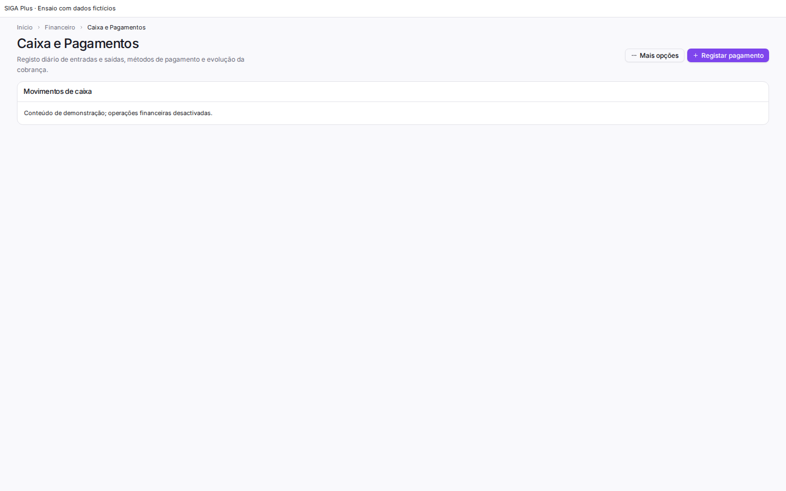 |

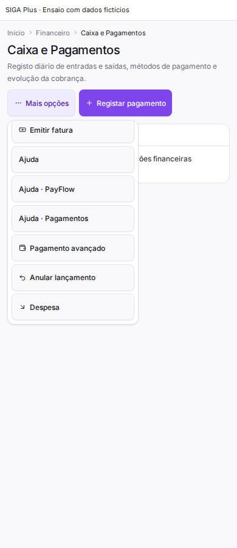

## Componentes alterados

- Layout: `AcademicNavTree`, `AppShell`, `NavItem`, `PageHeader` e novo `PageActionMenu`.
- Mobile: `MobileHeader`, `MoreHub`; contexto comum em `contextual-navigation.ts`.
- Rotas: Financeiro, Calendário, Comunicações e perfil Alumni; estilos comuns da sidebar.
- Testes: contexto autorizado, cabeçalho móvel, árvore académica real, gaveta contextual real e persistência/teclado do menu de acções.

Nenhuma dependência de produção foi acrescentada. Não houve alteração de schema, backend, políticas de autorização ou regras de negócio. Os atalhos continuam a usar os destinos e parâmetros existentes. A autorização das rotas e do backend continua a ser necessária.

## Validação efectuada

- 77 testes passaram em 10 ficheiros seleccionados, cobrindo os componentes alterados e as rotas Financeiro, Calendário e Comunicações.
- Verificação TypeScript dirigida a 17 ficheiros alterados: zero diagnósticos. Não representa aprovação do TypeScript global do repositório.
- ESLint dirigido: zero erros; dois avisos de Fast Refresh já existentes em `NavItem` e `PageHeader`.
- Build de produção concluído com código de saída zero.
- Comparação AST dos atributos `onSubmit`, `onClick`, `disabled` e `fields`: 27 contratos Financeiro, 41 Calendário e 24 Comunicações preservados. Isto verifica o código, não executa operações financeiras.
- 16 cenários de navegador antes/depois. No estado corrigido: sem erros JavaScript ou overflow horizontal; popover académico sem corte; curso, turma e disciplina correctos; gaveta fecha ao navegar; destaque activo; menu financeiro dentro do ecrã; primeira/última opção atingíveis; Escape e foco após fechar modal verificados.
- Testes controlados com Administrador, Professor, Aluno e Utilizador; mudança de escola e ausência de autorização. Registo detalhado em [browser-results.json](browser-results.json).

## Verificação ainda pendente

É necessário confirmar numa sessão autenticada os perfis e permissões reais, o isolamento entre escolas e os fluxos completos de pagamentos, notas e comunicações. Não foram efectuadas submissões reais, testes em dispositivos físicos, avaliação com leitor de ecrã, teclado virtual ou auditoria formal de contraste/zoom. Volumes grandes de registos e formulários extensos exigem validação com dados representativos de cada escola. Não se declara a suite global nem o TypeScript global aprovados.

## Ajuste adicional: contorno da sidebar

O lado esquerdo ficou recto e encostado à margem do ecrã. Na junção com o conteúdo, o fundo da sidebar envolve os cantos esquerdos arredondados da superfície principal, formando curvas côncavas superior e inferior. Não há intervalo entre as duas superfícies. O efeito usa as superfícies existentes e aplica-se apenas à composição desktop; o menu móvel conserva a sua gaveta.

Verificação representativa no navegador a 1024 e 1440 px, aberta e recolhida: sidebar na coordenada x=0, junção contínua, quatro cantos próprios a 0 px, curvas da superfície principal presentes e nenhum overflow horizontal. Componentes de navegação reais; conta e rede controladas, como no ensaio anterior. Dados em [sidebar-shape-browser.json](sidebar-shape-browser.json).

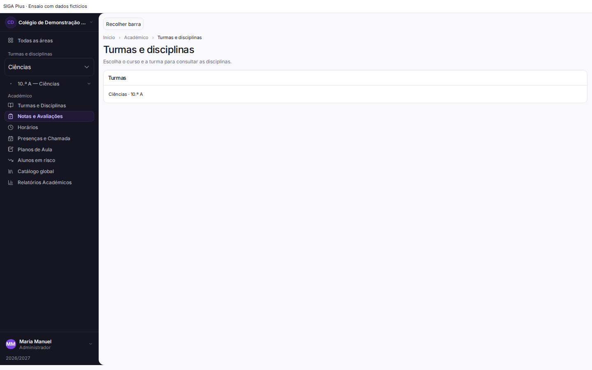

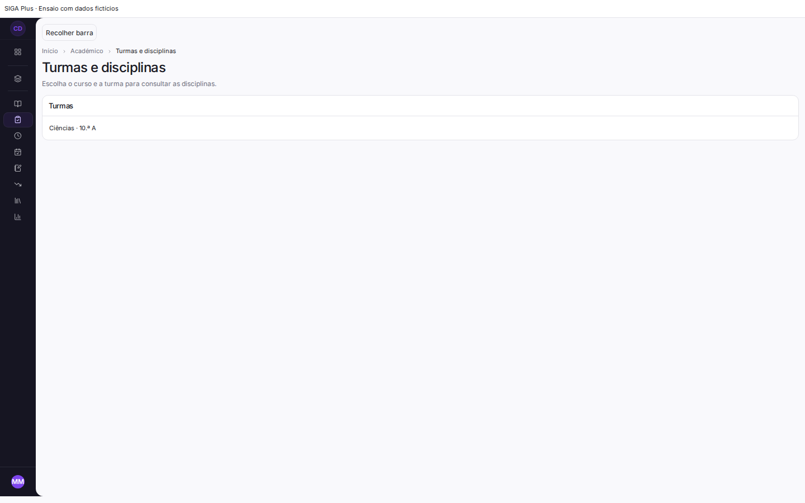
